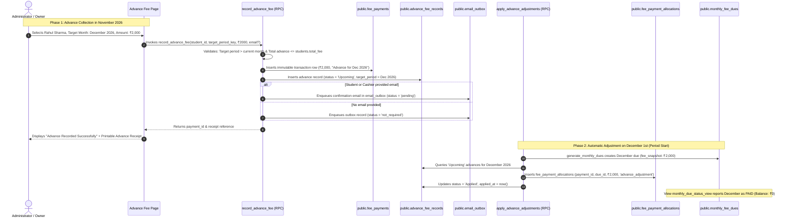

# Advance Fee Module & Automatic Month-Wise Adjustment Design

**Document Version:** 1.1.0 (Synchronized with Owner Decisions of 15-Nov-2026)  
**Standard Timezone:** `Asia/Kolkata` (IST, UTC+05:30)  
**Core Invariant:** Explicit Period Earmarking, Strict Allocation Ceilings, Admin-Only Audited Reversals

---

## 1. Architectural Workflow & Lifecycle

The Advance Fee module permits administrators to accept tuition payments earmarked for future calendar months while preserving complete ledger immutability:



---

## 2. Validation & Boundary Invariants

1. **Target Period Must Be Strictly in the Future:**
   - An advance can only be recorded for a future fee period (`target_period.start_date > (now() AT TIME ZONE 'Asia/Kolkata')::DATE`).
   - If an administrator wants to collect for the current month or an overdue past month, they must use the **normal Fees Section**.
2. **Ceiling Invariant Based on `students.total_fee` (Decision 2):**
   - The combined total of existing active advances + the new deposit for student $S$ in target period $P$ cannot exceed the student's monthly fee stored in `students.total_fee`:
     $$\sum (\text{Existing Active Advances}) + \text{New Amount} \le \text{Student.total\_fee}$$
   - **Scenario:** Rahul's monthly fee (`students.total_fee`) is ₹2,000. He deposits ₹1,000 on Nov 10 for Dec 2026. On Nov 15, he deposits ₹1,000. Total = ₹2,000. If he tries to deposit another ₹500 for December, the transaction is **strictly rejected with an over-allocation exception**.
3. **Partial Advance Handling:**
   - If Rahul deposits ₹1,200 for December 2026:
     - Advance record created with status `'Upcoming'`.
     - When December begins, ₹1,200 is allocated to December due.
     - December due balance becomes ₹800 (`PARTIALLY_PAID`).
     - Advance record status becomes `'Partially Applied'`.
     - The remaining ₹800 is collectible in one full payment of ₹800 via the normal Fees section.
4. **Student Email is Optional (Decision 1):**
   - Advance recording **never fails** if email is missing.
   - If no email is known, status is set to `'not_required'` in `email_outbox`.
   - If a new email is provided by cashier, it is used for sending the receipt; saving it to profile requires explicit confirmation and never silently overwrites.

---

## 3. Stored Procedure DDL: `public.record_advance_fee`

```sql
CREATE OR REPLACE FUNCTION public.record_advance_fee(
    p_student_id UUID,
    p_target_period_key TEXT,
    p_amount NUMERIC,
    p_payment_mode TEXT,
    p_receipt_number TEXT DEFAULT NULL,
    p_remarks TEXT DEFAULT NULL,
    p_student_email TEXT DEFAULT NULL
)
RETURNS JSONB
LANGUAGE plpgsql
SECURITY DEFINER
SET search_path = public, pg_temp
AS $$
DECLARE
    v_caller_id UUID;
    v_caller_role TEXT;
    v_student public.students%ROWTYPE;
    v_period public.fee_periods%ROWTYPE;
    v_existing_advances NUMERIC(10, 2) := 0.00;
    v_payment_id UUID;
    v_advance_id UUID;
    v_clean_receipt TEXT;
    v_clean_remarks TEXT;
    v_recipient_email TEXT;
    v_outbox_status TEXT := 'not_required';
BEGIN
    -- 1. Authorization Check
    v_caller_id := auth.uid();
    IF v_caller_id IS NOT NULL THEN
        SELECT role INTO v_caller_role FROM public.admins WHERE user_id = v_caller_id;
        IF v_caller_role IS NULL OR v_caller_role NOT IN ('super_admin', 'admin', 'receptionist') THEN
            RAISE EXCEPTION 'Unauthorized: Caller is not an authorized staff member';
        END IF;
    END IF;

    -- 2. Input Validations
    IF p_amount IS NULL OR p_amount <= 0 THEN
        RAISE EXCEPTION 'Advance amount must be greater than zero';
    END IF;

    IF p_payment_mode IS NULL OR p_payment_mode NOT IN ('cash', 'upi', 'bank_transfer', 'cheque') THEN
        RAISE EXCEPTION 'Invalid payment mode %', p_payment_mode;
    END IF;

    -- 3. Validate Student & Existing Monthly Fee (Decision 2)
    SELECT * INTO v_student FROM public.students WHERE id = p_student_id;
    IF NOT FOUND THEN
        RAISE EXCEPTION 'Student % not found', p_student_id;
    END IF;

    IF v_student.status != 'active' THEN
        RAISE EXCEPTION 'Cannot record advance fee for inactive student (status: %)', v_student.status;
    END IF;

    IF v_student.total_fee IS NULL OR v_student.total_fee <= 0 THEN
        RAISE EXCEPTION 'Student % does not have a configured monthly fee amount', v_student.name;
    END IF;

    -- 4. Validate Target Period (Must be in future)
    SELECT * INTO v_period FROM public.fee_periods WHERE period_key = p_target_period_key;
    IF NOT FOUND THEN
        RAISE EXCEPTION 'Target fee period % not found', p_target_period_key;
    END IF;

    IF v_period.start_date <= (now() AT TIME ZONE 'Asia/Kolkata')::DATE THEN
        RAISE EXCEPTION 'Target period % is not a future period. Use normal Fees section for current/past dues.', v_period.period_name;
    END IF;

    -- 5. Validate Ceiling Invariant using students.total_fee (Decision 2)
    SELECT COALESCE(SUM(amount_received), 0.00) INTO v_existing_advances
    FROM public.advance_fee_records
    WHERE student_id = p_student_id
      AND target_period_id = v_period.id
      AND status IN ('Upcoming', 'Partially Applied');

    IF (v_existing_advances + p_amount) > v_student.total_fee THEN
        RAISE EXCEPTION 'Advance allocation exceeds monthly fee. Applicable monthly fee: ₹%, Already recorded: ₹%, Attempted: ₹%. Maximum allowed: ₹%',
            v_student.total_fee, v_existing_advances, p_amount, (v_student.total_fee - v_existing_advances);
    END IF;

    -- 6. Insert Immutable Transaction Row in public.fee_payments
    v_clean_receipt := NULLIF(trim(p_receipt_number), '');
    IF v_clean_receipt IS NULL THEN
        v_clean_receipt := 'REC-ADV-' || to_char((now() AT TIME ZONE 'Asia/Kolkata'), 'YYYYMMDD') || '-' || upper(substr(gen_random_uuid()::text, 1, 6));
    END IF;
    v_clean_remarks := 'Advance fee for ' || v_period.period_name || COALESCE(': ' || trim(p_remarks), '');

    INSERT INTO public.fee_payments (
        student_id, amount, payment_date, payment_mode, receipt_number, remarks, is_reversal, created_by
    ) VALUES (
        p_student_id, p_amount, (now() AT TIME ZONE 'Asia/Kolkata')::DATE, p_payment_mode, v_clean_receipt, v_clean_remarks, false, v_caller_id
    ) RETURNING id INTO v_payment_id;

    -- 7. Insert Advance Record
    INSERT INTO public.advance_fee_records (
        student_id, target_period_id, payment_id, amount_received, status, created_by
    ) VALUES (
        p_student_id, v_period.id, v_payment_id, p_amount, 'Upcoming', v_caller_id
    ) RETURNING id INTO v_advance_id;

    -- 8. Email Outbox Enqueueing (Decision 1: Optional Email)
    v_recipient_email := COALESCE(NULLIF(trim(p_student_email), ''), v_student.email);
    IF v_recipient_email IS NOT NULL AND length(v_recipient_email) > 0 THEN
        v_outbox_status := 'pending';
    END IF;

    INSERT INTO public.email_outbox (
        student_id, advance_record_id, recipient_email, subject, template_name, payload, status
    ) VALUES (
        p_student_id,
        v_advance_id,
        v_recipient_email,
        'Advance Fee Payment Receipt — ' || v_period.period_name,
        'advance_receipt',
        jsonb_build_object(
            'student_name', v_student.name,
            'admission_id', v_student.admission_id,
            'target_month', v_period.period_name,
            'amount', p_amount,
            'receipt_number', v_clean_receipt,
            'payment_mode', p_payment_mode,
            'date', (now() AT TIME ZONE 'Asia/Kolkata')::DATE
        ),
        v_outbox_status
    );

    RETURN jsonb_build_object(
        'success', true,
        'payment_id', v_payment_id,
        'advance_id', v_advance_id,
        'receipt_number', v_clean_receipt,
        'amount', p_amount,
        'target_period', v_period.period_name,
        'email_status', v_outbox_status
    );
END;
$$;

REVOKE ALL ON FUNCTION public.record_advance_fee(UUID, TEXT, NUMERIC, TEXT, TEXT, TEXT, TEXT) FROM PUBLIC, anon;
GRANT EXECUTE ON FUNCTION public.record_advance_fee(UUID, TEXT, NUMERIC, TEXT, TEXT, TEXT, TEXT) TO authenticated;
```

---

## 4. Automatic Month-Wise Advance Adjustment: `public.apply_advance_adjustments`

```sql
CREATE OR REPLACE FUNCTION public.apply_advance_adjustments(
    p_period_id UUID
)
RETURNS INT
LANGUAGE plpgsql
SECURITY DEFINER
SET search_path = public, pg_temp
AS $$
DECLARE
    v_rec RECORD;
    v_due RECORD;
    v_applied_count INT := 0;
    v_total_applied NUMERIC(10, 2);
BEGIN
    FOR v_rec IN
        SELECT a.id AS advance_id, a.student_id, a.payment_id, a.amount_received
        FROM public.advance_fee_records a
        WHERE a.target_period_id = p_period_id
          AND a.status IN ('Upcoming', 'Partially Applied')
        ORDER BY a.created_at ASC
    LOOP
        -- Find target monthly due
        SELECT id, fee_snapshot INTO v_due
        FROM public.monthly_fee_dues
        WHERE student_id = v_rec.student_id AND period_id = p_period_id;

        IF FOUND THEN
            -- Check if allocation already exists for this payment + due
            IF NOT EXISTS (
                SELECT 1 FROM public.fee_payment_allocations 
                WHERE payment_id = v_rec.payment_id AND due_id = v_due.id
            ) THEN
                INSERT INTO public.fee_payment_allocations (
                    payment_id, due_id, allocated_amount, allocation_type
                ) VALUES (
                    v_rec.payment_id, v_due.id, v_rec.amount_received, 'advance_adjustment'
                );

                -- Determine total applied advance for this student and period
                SELECT COALESCE(SUM(allocated_amount), 0.00) INTO v_total_applied
                FROM public.fee_payment_allocations
                WHERE due_id = v_due.id AND allocation_type = 'advance_adjustment';

                -- Update advance status
                IF v_total_applied >= v_due.fee_snapshot THEN
                    UPDATE public.advance_fee_records
                    SET status = 'Applied', applied_at = (now() AT TIME ZONE 'Asia/Kolkata')
                    WHERE id = v_rec.advance_id;
                ELSE
                    UPDATE public.advance_fee_records
                    SET status = 'Partially Applied', applied_at = (now() AT TIME ZONE 'Asia/Kolkata')
                    WHERE id = v_rec.advance_id;
                END IF;

                v_applied_count := v_applied_count + 1;
            END IF;
        END IF;
    END LOOP;

    RETURN v_applied_count;
END;
$$;
```

---

## 5. Admin-Only Audited Advance Cancellation: `public.void_advance_fee` (Decision 6)

Per **Owner Decision 6**, only super administrators can void an advance fee. The original transaction is never deleted; an auditable reversal entry is created in `public.fee_payments`, and any active allocations are rolled back:

```sql
CREATE OR REPLACE FUNCTION public.void_advance_fee(
    p_advance_id UUID,
    p_void_reason TEXT
)
RETURNS JSONB
LANGUAGE plpgsql
SECURITY DEFINER
SET search_path = public, pg_temp
AS $$
DECLARE
    v_caller_id UUID;
    v_caller_role TEXT;
    v_adv public.advance_fee_records%ROWTYPE;
    v_orig_pay public.fee_payments%ROWTYPE;
    v_reversal_pay_id UUID;
    v_reversal_receipt TEXT;
BEGIN
    -- 1. Strict Super-Admin Authorization Check (Decision 6)
    v_caller_id := auth.uid();
    IF v_caller_id IS NULL THEN
        RAISE EXCEPTION 'Authentication required';
    END IF;

    SELECT role INTO v_caller_role FROM public.admins WHERE user_id = v_caller_id;
    IF v_caller_role IS NULL OR v_caller_role != 'super_admin' THEN
        RAISE EXCEPTION 'Forbidden: Only super administrators can cancel advance fees. Managers and receptionists are strictly prohibited.';
    END IF;

    -- 2. Validate Reason
    IF p_void_reason IS NULL OR length(trim(p_void_reason)) < 5 THEN
        RAISE EXCEPTION 'A detailed cancellation reason (at least 5 characters) is required for audit compliance.';
    END IF;

    -- 3. Lock & Retrieve Advance Record
    SELECT * INTO v_adv 
    FROM public.advance_fee_records 
    WHERE id = p_advance_id 
    FOR UPDATE;

    IF NOT FOUND THEN
        RAISE EXCEPTION 'Advance record % not found', p_advance_id;
    END IF;

    IF v_adv.status = 'Voided' THEN
        RAISE EXCEPTION 'This advance record has already been voided';
    END IF;

    SELECT * INTO v_orig_pay FROM public.fee_payments WHERE id = v_adv.payment_id;

    -- 4. Create Reversal Transaction in public.fee_payments (Append-Only Ledger)
    v_reversal_receipt := 'REV-' || v_orig_pay.receipt_number;

    INSERT INTO public.fee_payments (
        student_id, amount, payment_date, payment_mode, receipt_number, remarks,
        is_reversal, reversal_of_id, void_reason, created_by
    ) VALUES (
        v_adv.student_id,
        v_adv.amount_received,
        (now() AT TIME ZONE 'Asia/Kolkata')::DATE,
        v_orig_pay.payment_mode,
        v_reversal_receipt,
        'Advance Reversal: ' || trim(p_void_reason),
        true,
        v_adv.payment_id,
        trim(p_void_reason),
        v_caller_id
    ) RETURNING id INTO v_reversal_pay_id;

    -- 5. Rollback Allocations If Advance Was Already Applied
    IF v_adv.status IN ('Applied', 'Partially Applied') THEN
        DELETE FROM public.fee_payment_allocations 
        WHERE payment_id = v_adv.payment_id;
    END IF;

    -- 6. Transition Advance Status to Voided
    UPDATE public.advance_fee_records
    SET status = 'Voided',
        voided_at = (now() AT TIME ZONE 'Asia/Kolkata'),
        voided_by = v_caller_id,
        void_reason = trim(p_void_reason),
        reversal_payment_id = v_reversal_pay_id
    WHERE id = p_advance_id;

    -- 7. Cancel Any Pending Outbox Email
    UPDATE public.email_outbox
    SET status = 'not_required', last_error = 'Advance voided by admin'
    WHERE advance_record_id = p_advance_id AND status = 'pending';

    RETURN jsonb_build_object(
        'success', true,
        'advance_id', p_advance_id,
        'reversal_payment_id', v_reversal_pay_id,
        'reversal_receipt', v_reversal_receipt,
        'void_reason', trim(p_void_reason),
        'timestamp', (now() AT TIME ZONE 'Asia/Kolkata')
    );
END;
$$;

REVOKE ALL ON FUNCTION public.void_advance_fee(UUID, TEXT) FROM PUBLIC, anon;
GRANT EXECUTE ON FUNCTION public.void_advance_fee(UUID, TEXT) TO authenticated;

COMMENT ON FUNCTION public.void_advance_fee IS 'Privileged Super-Admin RPC that creates an auditable reversal in fee_payments and voids an advance record';
```
