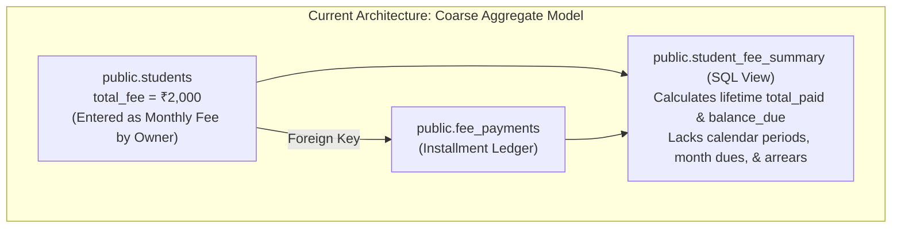

# Current Fee Architecture & System Audit

**Audit Date:** 2026-11-15  
**Review Standard:** Strict Read-Only Audit of Existing Implementation  
**Audited Location:** `D:/institute_app`  
**Timezone Standard:** `Asia/Kolkata` (IST, UTC+05:30)

---

## 1. Architectural Overview & System Model

The existing financial module in the Z Institute Management System was originally built as a **Course Total Fee + Installment Ledger**:

1. In the database schema, every student has a fee field `students.total_fee`.
2. Payments are recorded as installment rows in `public.fee_payments`.
3. The SQL view `public.student_fee_summary` computes:
   $$\text{Balance Due} = \text{Total Fee} - \text{Total Paid}$$
4. However, per **Owner Decision 2 (15-Nov-2026)**:
   > *"The owner already enters the student's monthly fee during student creation. Reuse the existing monthly fee field and its existing source of truth. Do not introduce a default ₹2,000 baseline. Do not derive monthly fees by dividing course total fees."*
5. In operational practice, the owner was inputting the student's individual **monthly tuition fee** (e.g. ₹2,000, ₹3,500) into `students.total_fee`, while the software lacked calendar month periodization and treated it as a single static total.



---

## 2. Inventory of Current Database Objects

### 2.1 Table: `public.students`
- **File Reference:** `migrations/0001_initial_schema.sql` (Lines 33–60)
- **Relevant Schema:**
  ```sql
  CREATE TABLE IF NOT EXISTS public.students (
      id UUID PRIMARY KEY DEFAULT gen_random_uuid(),
      admission_id TEXT NOT NULL,
      name TEXT NOT NULL,
      phone TEXT NOT NULL,
      course TEXT NOT NULL,
      joining_date DATE NOT NULL DEFAULT (now() AT TIME ZONE 'Asia/Kolkata')::DATE,
      total_fee NUMERIC(10, 2) NOT NULL,
      status TEXT NOT NULL DEFAULT 'active' CHECK (status IN ('active', 'completed', 'dropped')),
      notes TEXT,
      created_at TIMESTAMPTZ NOT NULL DEFAULT (now() AT TIME ZONE 'Asia/Kolkata'),
      updated_at TIMESTAMPTZ NOT NULL DEFAULT (now() AT TIME ZONE 'Asia/Kolkata'),
      CONSTRAINT check_total_fee_positive CHECK (total_fee >= 0)
  );
  ```
- **Finding:** `total_fee` is the single fee field on `students`. Per Decision 2, this is the exact field that stores each student's individual monthly fee. It currently lacks an `email` column (`NOT IMPLEMENTED`), which will be added as an optional nullable column in Phase 1 (Decision 1).

### 2.2 Table: `public.fee_payments`
- **File Reference:** `migrations/0001_initial_schema.sql` (Lines 64–96)
- **Relevant Schema:**
  ```sql
  CREATE TABLE IF NOT EXISTS public.fee_payments (
      id UUID PRIMARY KEY DEFAULT gen_random_uuid(),
      student_id UUID NOT NULL REFERENCES public.students(id) ON DELETE RESTRICT,
      amount NUMERIC(10, 2) NOT NULL,
      payment_date DATE NOT NULL DEFAULT (now() AT TIME ZONE 'Asia/Kolkata')::DATE,
      payment_mode TEXT NOT NULL DEFAULT 'cash' CHECK (payment_mode IN ('cash', 'upi', 'bank_transfer', 'cheque')),
      receipt_number TEXT,
      remarks TEXT,
      is_reversal BOOLEAN NOT NULL DEFAULT false,
      reversal_of_id UUID REFERENCES public.fee_payments(id) ON DELETE RESTRICT,
      void_reason TEXT,
      created_by UUID REFERENCES auth.users(id),
      created_at TIMESTAMPTZ NOT NULL DEFAULT (now() AT TIME ZONE 'Asia/Kolkata'),
      CONSTRAINT check_payment_amount_positive CHECK (amount > 0)
  );
  ```
- **Finding:** Outstanding ledger immutability and audit-trail design (`VERIFIED`). All payments and reversals flow through this table. In the redesign, this table remains the single authoritative financial cashflow ledger.

### 2.3 SQL View: `public.student_fee_summary`
- **File Reference:** `migrations/0002_create_fee_summary_view.sql` (Lines 7–43)
- **Calculation Logic:** Aggregates lifetime payments into a single scalar sum without monthly boundaries.
- **Finding:** Replaced for operational billing by the new view `public.monthly_due_status_view`, which calculates month-wise fee snapshots, advance adjustments, and independent statuses (`UNPAID`, `PARTIALLY_PAID`, `PAID`).

### 2.4 Stored Function: `public.reverse_payment`
- **File Reference:** `migrations/0003_create_stored_functions.sql` (Lines 113–201)
- **Finding:** Robust, secure audit trail for payment reversals restricted to `super_admin` (`VERIFIED`).

---

## 3. Frontend Architecture Inventory

- **Page:** `client/src/pages/FeesPage.tsx`
  - Current implementation displays a single aggregate table based on `student_fee_summary`.
  - Computes lifetime collection metrics rather than monthly period metrics.
- **Modals:**
  - `RecordPaymentModal.tsx`: Accepts arbitrary partial payments towards lifetime balance.
  - `PrintableReceipt.tsx`: Displays lifetime total fee and balance remaining rather than billing period.
  - `PaymentHistoryModal.tsx`: Displays list of historical payments.
- **Services:**
  - `client/src/services/fees.ts`: Interfaces directly with `student_fee_summary` and `fee_payments`.

---

## 4. Architectural Transformation Plan Summary

| Component | Existing Legacy State | Redesigned State (Synchronized with Owner Decisions) |
| :--- | :--- | :--- |
| **Student Fee Field** | `students.total_fee` interpreted as coarse course total | Reused directly as individual monthly fee source of truth (Decision 2). |
| **Student Email** | None (`NULL`) | Optional `email TEXT` column added to `students` (Decision 1). |
| **Billing Period** | None (All-time aggregate) | Granular `fee_periods` table starting **November 2026** (Decision 5). |
| **Monthly Due Status** | Global status (`PAID` / `PARTIAL` / `UNPAID`) | Independent status per calendar month (`monthly_due_status_view`). |
| **Normal Collection** | Any arbitrary amount accepted | **Strict full payment only** of remaining month balance; partial and overpayments rejected. |
| **Advance Payments** | Not supported (credited to global balance) | Dedicated `/advance-fees` page; strictly earmarked to future months up to monthly fee ceiling. |
| **Advance Cancellation** | Not supported | Super Admin only audited reversal creating ledger entry in `fee_payments` (Decision 6). |
| **Automation** | None | **Hybrid Architecture**: `pg_cron` at `00:01 IST` on 1st of month + on-demand fallback (Decision 4). |
| **Notifications** | None | Asynchronous `email_outbox` via **Resend Free Plan** (3k/mo, 100/day) (Decision 3). |
