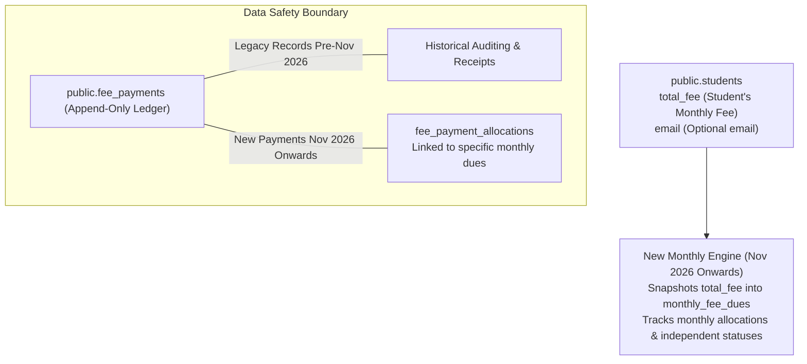

# Data Migration Strategy & Backward Compatibility Plan

**Document Version:** 1.1.0 (Synchronized with Owner Decisions of 15-Nov-2026)  
**Safety Directives:** Strict Zero-Data-Loss, Reusing Existing Student Fee Field, Zero Retroactive Backfill  
**Target Tables:** `public.students`, `public.fee_payments`, `public.student_fee_summary`

---

## 1. Existing Data Audit & Clarification

### 1.1 Source of Truth: Existing Student Monthly Fee Field
- **Database Column:** `public.students.total_fee NUMERIC(10, 2) NOT NULL`
- **Frontend Field:** `total_fee` in `client/src/components/students/AddStudentModal.tsx` & `EditStudentModal.tsx`
- **Owner Directive (Decision 2):**  
  The owner already enters the student's individual monthly fee during student enrollment into `students.total_fee`. We **reuse this existing field directly** as the single source of truth for each student's monthly fee amount.
- **Prohibitions Upheld:**
  - **No Artificial Baseline:** Do not apply any arbitrary ₹2,000 or default baseline.
  - **No Course Division:** Do not divide total fees by course duration.
  - **No Duplicate Columns:** Do not introduce a duplicate `monthly_fee` column or configuration table.

### 1.2 Historical Payment Ledger (`public.fee_payments`)
- `public.fee_payments` contains historical transaction rows recorded prior to November 2026.
- Per **Owner Decision 5**, all existing payment rows remain **100% permanently preserved**.
- **Zero Retroactive Backfill:** We will **not** generate synthetic monthly dues for October 2026 or earlier, and we will **not** attempt to retroactively map past payments into the new monthly allocation table. Past payments remain accessible in payment history and reports for historical auditing.

---

## 2. Backward-Compatible Coexistence Architecture

The system transitions smoothly into monthly billing starting from **November 2026**:



### Schema Addition:
Only the optional `email` column is added to `public.students`:
```sql
ALTER TABLE public.students 
ADD COLUMN IF NOT EXISTS email TEXT DEFAULT NULL;

COMMENT ON COLUMN public.students.total_fee IS 'Authoritative individual monthly tuition fee entered during student enrollment';
COMMENT ON COLUMN public.students.email IS 'Optional student/parent email address for advance receipts';
```

---

## 3. Step-by-Step Migration Execution

### Phase M1: Non-Destructive Additive Schema Expansion
- Apply migrations creating `public.fee_periods`, `public.monthly_fee_dues`, `public.fee_payment_allocations`, `public.advance_fee_records`, and `public.email_outbox`.
- Add nullable `email` column to `public.students`.
- **Data Impact:** Absolute zero impact on existing tables, rows, or constraints. Existing student records, course lists, batches, and historical payments remain intact.

### Phase M2: Seed Initial Fee Periods
- Seed standardized billing periods starting from **November 2026**:
  ```sql
  INSERT INTO public.fee_periods (period_key, period_name, start_date, end_date, due_date, is_active)
  VALUES 
      ('2026-11', 'November 2026', '2026-11-01', '2026-11-30', '2026-11-10', true),
      ('2026-12', 'December 2026', '2026-12-01', '2026-12-31', '2026-12-10', true),
      ('2027-01', 'January 2027',   '2027-01-01', '2027-01-31', '2027-01-10', true)
  ON CONFLICT (period_key) DO NOTHING;
  ```

### Phase M3: Initial Monthly Due Generation (November 2026)
- Trigger `generate_monthly_dues('2026-11')`.
- For every active student whose `joining_date <= '2026-11-30'`, an initial monthly due is created with:
  - `fee_snapshot = students.total_fee`
  - `amount_paid = 0.00`
  - `advance_applied = 0.00`
  - `outstanding_balance = students.total_fee`
  - `status = 'UNPAID'`
- Students enrolled after November 30, 2026 are excluded.

### Phase M4: Historical Ledger Preservation
- All past rows in `public.fee_payments` remain available for export and historical review.
- The legacy `public.student_fee_summary` view remains operational.
- New monthly payments link directly to `monthly_fee_dues` via `fee_payment_allocations`.

---

## 4. Rollback & Recovery Procedures

If rollback is ever mandated:
1. **Schema Reversibility:**
   The new tables have no destructive constraints on existing tables. Dropping them reverts the system cleanly:
   ```sql
   DROP VIEW IF EXISTS public.monthly_due_status_view;
   DROP TABLE IF EXISTS public.fee_payment_allocations;
   DROP TABLE IF EXISTS public.advance_fee_records;
   DROP TABLE IF EXISTS public.monthly_fee_dues;
   DROP TABLE IF EXISTS public.fee_periods;
   DROP TABLE IF EXISTS public.email_outbox;
   ALTER TABLE public.students DROP COLUMN IF EXISTS email;
   ```
2. **Zero Core Data Loss:**
   `public.students` and `public.fee_payments` are never modified or truncated, guaranteeing 100% data preservation.
