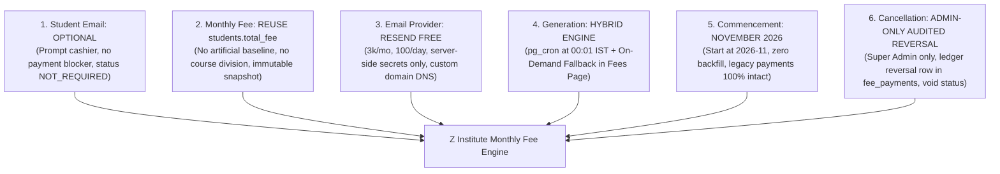

# Owner Decision Confirmation & Architecture Alignment

**Document Version:** 1.0.0 (Binding Architectural Baseline)  
**Confirmation Date:** 2026-11-15  
**Governing Standard:** Z Institute Management System — Phase 0 Architectural Blueprint

---

## 1. Executive Confirmation of Approved Decisions

The owner has formally reviewed and locked all six architectural decision items. All 12 planning and design documents inside `D:/institute_app/FEE_MODULE_IMPLEMENTATION/` have been updated and synchronized with these decisions.

---

## 2. In-Depth Verification of Decisions & Codebase Alignment

### Decision 1: Student Email — OPTIONAL
- **Architectural Directive:** Student email is not mandatory for student creation or advance fee recording. If registered email exists in `students.email`, use it. If not, optionally allow the cashier to enter an email during advance recording. If no email is provided, proceed with advance recording, print physical receipt, and set outbox status to `not_required`. Do not silently overwrite profile email.
- **Database Alignment:**
  - `ALTER TABLE public.students ADD COLUMN IF NOT EXISTS email TEXT DEFAULT NULL;` (nullable).
  - `email_outbox.status` check constraint includes `'not_required'` alongside `'pending'`, `'sent'`, `'failed'`.
- **Frontend Alignment:**
  - `RecordAdvanceModal.tsx` provides an optional email input with a separate, unselected checkbox: *"Save this email to student profile"*. Missing email does not disable submit.

---

### Decision 2: Individual Monthly Fee — REUSE EXISTING FIELD (`students.total_fee`)
- **Source Code Verification:**
  - **Schema Definition (`migrations/0001_initial_schema.sql`, line 44):**  
    `total_fee NUMERIC(10, 2) NOT NULL CONSTRAINT check_total_fee_positive CHECK (total_fee >= 0)`
  - **Frontend Form (`client/src/components/students/AddStudentModal.tsx`, line 247):**  
    Input field `id="total_fee"` with numeric step and validation.
- **Architectural Resolution:**
  - In operational practice, the owner already inputs each student's individual monthly fee into this exact field during enrollment.
  - We **reject the proposed flat ₹2,000 baseline** and **reject course duration division**.
  - We reuse `students.total_fee` directly as the authoritative source of truth for the student's monthly fee.
  - When `generate_monthly_dues` runs, it snapshots `students.total_fee` into `monthly_fee_dues.fee_snapshot`.
  - Future edits to `students.total_fee` follow the effective-date rule for future months; historical monthly dues snapshots remain permanently immutable.

---

### Decision 3: Transactional Email Provider — RESEND (Free Plan)
- **Official Resend Free Plan Specifications:**
  - **Quota Limits:** 3,000 emails per month, 100 emails per day.
  - **Domain Limit:** 1 custom verified domain (with SPF, DKIM, and DMARC DNS verification).
  - **Overages:** Hard cap. Resend does not automatically bill overages unless explicitly upgraded to Pro ($20/month).
- **Security & Decoupling Invariants:**
  - Private API key (`RESEND_API_KEY`) is stored strictly in server-side configuration (`.env.local` / Supabase Vault). It is **never** exposed to the React Vite bundle (`NO VITE_RESEND_API_KEY`).
  - If the 100 emails/day quota is reached, outbox records remain in `failed` / `pending` state with error diagnostic. Financial transactions are **never** rolled back on email errors.
  - Test mode sending (using onboarding domain `onboarding@resend.dev`) is restricted to the account owner's email (`saifirihan683@gmail.com`). Live sending to arbitrary student inboxes requires adding and verifying the institute's custom sending domain via DNS.

---

### Decision 4: Monthly Generation Automation — HYBRID ARCHITECTURE
- **Approved Mechanisms:**
  1. **Primary (`pg_cron`):** PostgreSQL scheduled job executing at `00:01 Asia/Kolkata` on the 1st of every month:
     `SELECT cron.schedule('generate-monthly-dues-auto', '1 18 * * *', 'SELECT public.generate_monthly_dues(to_char((now() AT TIME ZONE ''Asia/Kolkata''), ''YYYY-MM''))');`
  2. **Fallback (On-Demand):** When an authorized staff member opens the Fees page, the frontend verifies if the current month's dues have been generated; if not, it invokes `generate_monthly_dues('YYYY-MM')`.
- **Guarantees:**
  - Both mechanisms invoke the exact same database stored procedure.
  - Strictly idempotent via `ON CONFLICT (student_id, period_id) DO NOTHING`.
  - Execution audit trail stored in `public.monthly_generation_logs`.

---

### Decision 5: Billing Commencement — NOVEMBER 2026
- **Starting Period:** November 2026 (`2026-11`).
- **Boundaries & Safety:**
  - Dues will **only** be generated for periods $\ge \text{'2026-11'}$.
  - Stored procedure explicitly blocks any period $< \text{'2026-11'}$ with `ERR_HISTORICAL_PERIOD_PROTECTED`.
  - **Zero Retroactive Backfill:** No synthetic monthly dues created for October 2026 or earlier.
  - All pre-existing transaction rows in `public.fee_payments` remain 100% intact and queryable for historical auditing.
  - Admission eligibility cutoff: Students must have `joining_date <= period.end_date` and `status = 'active'`.

---

### Decision 6: Advance Cancellation — ADMIN-ONLY AUDITED REVERSAL
- **Privilege Separation:**
  - Privileged to `super_admin` only.
  - Managers (`manager`) and receptionists (`receptionist`) are strictly forbidden from cancelling advances (`403 Forbidden` / Exception thrown).
- **Audit & Invariant Preservation:**
  - The original advance receipt and ledger rows are **never deleted**.
  - A balancing reversal row is created in `public.fee_payments` (`is_reversal = true`, `reversal_of_id = payment_id`, `void_reason = reason`).
  - Any applied allocations are reversed transactionally, restoring monthly due balances.
  - Advance status transitions to `Voided`, capturing `voided_at`, `voided_by`, `void_reason`, and `reversal_payment_id`.

---

## 3. Reconfirmation of the Critical Monthly Status Rule

The owner's core requirement is strictly enforced across all database queries, views, and frontend components:

> **Every monthly fee due has a 100% independent status.**
> 
> Example:
> - **November 2026:** `UNPAID` (Balance: ₹2,000)
> - **December 2026:** `PAID` (Balance: ₹0)
> - **January 2027:** `UNPAID` (Balance: ₹2,000)
> 
> *Paying December marks December `PAID` without altering November or January. November remains `UNPAID` until explicitly paid via normal collection for November or covered by an advance targeting November. Dues never reset upon month rollover.*

---

## 4. Status of Phase 0

All 12 architectural documents have been updated and are 100% consistent with the owner's decisions.  
**Phase 0 is complete. Implementation is halted pending explicit authorization to proceed to Phase 1.**
