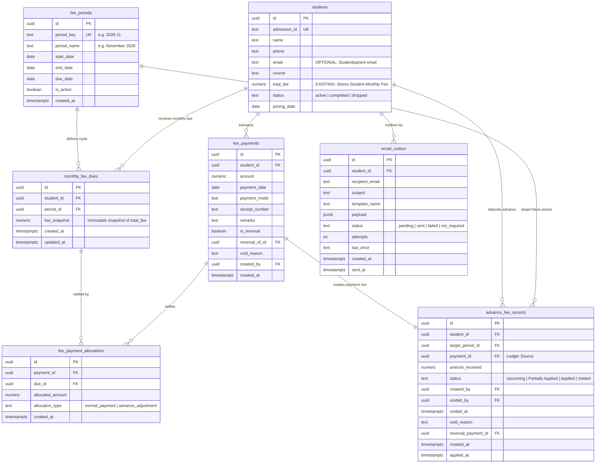

# Proposed Database Architecture & DDL Specification

**Document Version:** 1.1.0 (Synchronized with Owner Decisions of 15-Nov-2026)  
**Target RDBMS:** PostgreSQL 15+ (Supabase)  
**Timezone Standard:** `Asia/Kolkata` (IST, UTC+05:30)  
**Design Mandate:** Zero Replacement of `public.fee_payments`, Absolute Ledger Immutability, Exact `NUMERIC(10, 2)` Precision.

---

## 1. Architectural Relationship Diagram



---

## 2. Table-by-Table Schema DDL Specifications

### 2.1 Reusing Existing Student Fee Field & Adding Optional Email
Per **Owner Decision 2**, the owner already enters the student's monthly fee into `public.students.total_fee` during enrollment. We reuse this existing field as the source of truth for each student's monthly fee. We do **not** add an artificial baseline or duplicate fee column.

Per **Owner Decision 1**, we add an optional, nullable `email` column:

```sql
-- Add optional student email column
ALTER TABLE public.students 
ADD COLUMN IF NOT EXISTS email TEXT;

COMMENT ON COLUMN public.students.total_fee IS 'Authoritative individual monthly tuition fee entered during student enrollment';
COMMENT ON COLUMN public.students.email IS 'Optional student/parent email address for advance receipts and notices';
```

---

### 2.2 Table: `public.fee_periods` (Billing Cycles)
Stores formal calendar fee periods with boundary constraints. Starts from **November 2026** per **Owner Decision 5**:

```sql
CREATE TABLE IF NOT EXISTS public.fee_periods (
    id UUID PRIMARY KEY DEFAULT gen_random_uuid(),
    period_key TEXT NOT NULL UNIQUE, -- e.g. '2026-11'
    period_name TEXT NOT NULL,       -- e.g. 'November 2026'
    start_date DATE NOT NULL,
    end_date DATE NOT NULL,
    due_date DATE NOT NULL,
    is_active BOOLEAN NOT NULL DEFAULT true,
    created_at TIMESTAMPTZ NOT NULL DEFAULT (now() AT TIME ZONE 'Asia/Kolkata'),

    CONSTRAINT check_period_dates CHECK (start_date <= end_date AND due_date >= start_date),
    CONSTRAINT check_period_key_format CHECK (period_key ~ '^\d{4}-\d{2}$')
);

CREATE INDEX IF NOT EXISTS idx_fee_periods_dates ON public.fee_periods(start_date, end_date);
CREATE INDEX IF NOT EXISTS idx_fee_periods_active ON public.fee_periods(is_active);

COMMENT ON TABLE public.fee_periods IS 'Standardized monthly billing calendar periods starting November 2026';
```

---

### 2.3 Table: `public.monthly_fee_dues` (Individual Monthly Obligations)
Stores exactly one fee obligation per student per applicable month:

```sql
CREATE TABLE IF NOT EXISTS public.monthly_fee_dues (
    id UUID PRIMARY KEY DEFAULT gen_random_uuid(),
    student_id UUID NOT NULL REFERENCES public.students(id) ON DELETE RESTRICT,
    period_id UUID NOT NULL REFERENCES public.fee_periods(id) ON DELETE RESTRICT,
    fee_snapshot NUMERIC(10, 2) NOT NULL, -- Permanent historical snapshot of students.total_fee
    created_at TIMESTAMPTZ NOT NULL DEFAULT (now() AT TIME ZONE 'Asia/Kolkata'),
    updated_at TIMESTAMPTZ NOT NULL DEFAULT (now() AT TIME ZONE 'Asia/Kolkata'),

    CONSTRAINT check_due_amount_positive CHECK (fee_snapshot > 0),
    CONSTRAINT unique_student_period_due UNIQUE (student_id, period_id)
);

CREATE INDEX IF NOT EXISTS idx_monthly_dues_student ON public.monthly_fee_dues(student_id);
CREATE INDEX IF NOT EXISTS idx_monthly_dues_period ON public.monthly_fee_dues(period_id);

COMMENT ON TABLE public.monthly_fee_dues IS 'Authoritative monthly fee dues per student with immutable fee snapshots';
```

---

### 2.4 Table: `public.fee_payment_allocations` (Settlement Junction)
Bridges existing immutable payment records (`public.fee_payments`) with specific monthly dues:

```sql
CREATE TABLE IF NOT EXISTS public.fee_payment_allocations (
    id UUID PRIMARY KEY DEFAULT gen_random_uuid(),
    payment_id UUID NOT NULL REFERENCES public.fee_payments(id) ON DELETE RESTRICT,
    due_id UUID NOT NULL REFERENCES public.monthly_fee_dues(id) ON DELETE RESTRICT,
    allocated_amount NUMERIC(10, 2) NOT NULL,
    allocation_type TEXT NOT NULL DEFAULT 'normal_payment' 
        CHECK (allocation_type IN ('normal_payment', 'advance_adjustment')),
    created_at TIMESTAMPTZ NOT NULL DEFAULT (now() AT TIME ZONE 'Asia/Kolkata'),

    CONSTRAINT check_allocated_amount_positive CHECK (allocated_amount > 0)
);

CREATE INDEX IF NOT EXISTS idx_allocations_payment ON public.fee_payment_allocations(payment_id);
CREATE INDEX IF NOT EXISTS idx_allocations_due ON public.fee_payment_allocations(due_id);

COMMENT ON TABLE public.fee_payment_allocations IS 'Immutable allocation mapping payments to specific monthly dues';
```

---

### 2.5 Table: `public.advance_fee_records` (Advance Deposits Registry)
Manages future-period advance fee receipts and their lifecycle. Includes audit columns for **Decision 6 (Admin-Only Reversals)**:

```sql
CREATE TABLE IF NOT EXISTS public.advance_fee_records (
    id UUID PRIMARY KEY DEFAULT gen_random_uuid(),
    student_id UUID NOT NULL REFERENCES public.students(id) ON DELETE RESTRICT,
    target_period_id UUID NOT NULL REFERENCES public.fee_periods(id) ON DELETE RESTRICT,
    payment_id UUID NOT NULL REFERENCES public.fee_payments(id) ON DELETE RESTRICT,
    amount_received NUMERIC(10, 2) NOT NULL,
    status TEXT NOT NULL DEFAULT 'Upcoming' 
        CHECK (status IN ('Upcoming', 'Partially Applied', 'Applied', 'Voided')),
    created_by UUID REFERENCES auth.users(id),
    created_at TIMESTAMPTZ NOT NULL DEFAULT (now() AT TIME ZONE 'Asia/Kolkata'),
    applied_at TIMESTAMPTZ,
    
    -- Admin Reversal Audit Fields (Decision 6)
    voided_by UUID REFERENCES auth.users(id),
    voided_at TIMESTAMPTZ,
    void_reason TEXT,
    reversal_payment_id UUID REFERENCES public.fee_payments(id),

    CONSTRAINT check_advance_amount_positive CHECK (amount_received > 0)
);

CREATE INDEX IF NOT EXISTS idx_advance_student ON public.advance_fee_records(student_id);
CREATE INDEX IF NOT EXISTS idx_advance_target_period ON public.advance_fee_records(target_period_id);
CREATE INDEX IF NOT EXISTS idx_advance_status ON public.advance_fee_records(status);

COMMENT ON TABLE public.advance_fee_records IS 'Ledger of advance tuition fees earmarked for specific future billing periods';
```

---

### 2.6 Table: `public.email_outbox` (Asynchronous Notification Queue)
Guarantees reliable, retryable email delivery via Resend. Accommodates **Decision 1 (Optional Email)** via status `'not_required'`:

```sql
CREATE TABLE IF NOT EXISTS public.email_outbox (
    id UUID PRIMARY KEY DEFAULT gen_random_uuid(),
    student_id UUID REFERENCES public.students(id) ON DELETE SET NULL,
    advance_record_id UUID REFERENCES public.advance_fee_records(id) ON DELETE CASCADE,
    recipient_email TEXT,
    subject TEXT NOT NULL,
    template_name TEXT NOT NULL,
    payload JSONB NOT NULL,
    status TEXT NOT NULL DEFAULT 'pending' 
        CHECK (status IN ('pending', 'sent', 'failed', 'not_required')),
    attempts INT NOT NULL DEFAULT 0,
    last_error TEXT,
    created_at TIMESTAMPTZ NOT NULL DEFAULT (now() AT TIME ZONE 'Asia/Kolkata'),
    sent_at TIMESTAMPTZ
);

CREATE INDEX IF NOT EXISTS idx_outbox_pending ON public.email_outbox(status, created_at) WHERE status = 'pending';

COMMENT ON TABLE public.email_outbox IS 'Transactional outbox for asynchronous email notifications with retry capabilities';
```

---

## 3. Real-Time View: `public.monthly_due_status_view`

Provides atomic calculation of payments, advances, outstanding balances, and independent month status:

```sql
CREATE OR REPLACE VIEW public.monthly_due_status_view
WITH (security_invoker = true) AS
SELECT 
    d.id AS due_id,
    s.id AS student_id,
    s.admission_id,
    s.name AS student_name,
    s.phone AS student_phone,
    s.email AS student_email,
    s.course AS student_course,
    p.id AS period_id,
    p.period_key,
    p.period_name,
    p.start_date AS period_start,
    p.end_date AS period_end,
    p.due_date,
    d.fee_snapshot,
    
    -- Allocations from normal payments (net of any reversals)
    COALESCE(
        SUM(
            CASE 
                WHEN a.allocation_type = 'normal_payment' AND pay.is_reversal = false THEN a.allocated_amount
                WHEN a.allocation_type = 'normal_payment' AND pay.is_reversal = true THEN -a.allocated_amount
                ELSE 0.00 
            END
        ), 0.00
    ) AS normal_paid_amount,

    -- Allocations from advances applied (net of reversals)
    COALESCE(
        SUM(
            CASE 
                WHEN a.allocation_type = 'advance_adjustment' AND pay.is_reversal = false THEN a.allocated_amount
                WHEN a.allocation_type = 'advance_adjustment' AND pay.is_reversal = true THEN -a.allocated_amount
                ELSE 0.00 
            END
        ), 0.00
    ) AS advance_applied_amount,

    -- Total Net Settled
    COALESCE(
        SUM(
            CASE 
                WHEN pay.is_reversal = true THEN -a.allocated_amount
                ELSE a.allocated_amount 
            END
        ), 0.00
    ) AS total_settled_amount,

    -- Outstanding Balance
    (
        d.fee_snapshot - COALESCE(
            SUM(
                CASE 
                    WHEN pay.is_reversal = true THEN -a.allocated_amount
                    ELSE a.allocated_amount 
                END
            ), 0.00
        )
    ) AS balance_remaining,

    -- Independent Monthly Status
    CASE 
        WHEN COALESCE(SUM(CASE WHEN pay.is_reversal = true THEN -a.allocated_amount ELSE a.allocated_amount END), 0.00) >= d.fee_snapshot THEN 'PAID'
        WHEN COALESCE(SUM(CASE WHEN pay.is_reversal = true THEN -a.allocated_amount ELSE a.allocated_amount END), 0.00) > 0 THEN 'PARTIAL'
        ELSE 'UNPAID'
    END AS status,

    -- Arrears Flag: Due date in past with outstanding balance
    CASE 
        WHEN p.end_date < (now() AT TIME ZONE 'Asia/Kolkata')::DATE 
             AND (d.fee_snapshot - COALESCE(SUM(CASE WHEN pay.is_reversal = true THEN -a.allocated_amount ELSE a.allocated_amount END), 0.00)) > 0 
        THEN true 
        ELSE false 
    END AS is_arrears

FROM public.monthly_fee_dues d
JOIN public.students s ON d.student_id = s.id
JOIN public.fee_periods p ON d.period_id = p.id
LEFT JOIN public.fee_payment_allocations a ON d.id = a.due_id
LEFT JOIN public.fee_payments pay ON a.payment_id = pay.id
GROUP BY d.id, s.id, p.id;

COMMENT ON VIEW public.monthly_due_status_view IS 'Real-time calculation of month-wise fee dues, advance adjustments, remaining balances and independent statuses';
```

---

## 4. Single Source of Truth Guarantee

- All financial cashflows **flow exclusively through `public.fee_payments`**.
- Whether a student pays a normal monthly due, deposits an advance, or has an advance cancelled by an admin, a single immutable or balancing row is created in `public.fee_payments`.
- Tables `fee_payment_allocations` and `advance_fee_records` reference `fee_payments.id` via foreign key `ON DELETE RESTRICT`.
- There is **zero duplicate ledger**, zero conflicting totals, and zero floating-point risk.
