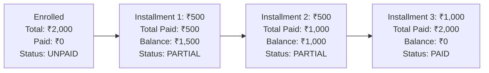

# Z Institute Management System — Fee Cycle & Financial Verification Report

## 1. Executive Summary & Architecture Discovery

### 1.1 Documented Fee Model vs. Recurring Monthly Subscription
During Phase 0 discovery, a critical business rule distinction was evaluated:
- **Application's Documented & Implemented Architecture:** The system implements a **Course-Based Total Fee with an Immutable Installment Ledger**. Each student is enrolled with an agreed `total_fee` (e.g. ₹2,000 or ₹12,000 for a multi-month course). Payments are collected as chronological installments in `public.fee_payments`. The real-time view `public.student_fee_summary` calculates:
  $$\text{Total Paid} = \sum (\text{Installments}) - \sum (\text{Authorized Reversals})$$
  $$\text{Balance Due} = \text{Total Course Fee} - \text{Total Paid}$$
  $$\text{Fee Status} = \begin{cases} \text{PAID} & \text{if Total Paid} \ge \text{Total Course Fee} \\ \text{PARTIAL} & \text{if Total Paid} > 0 \text{ and } < \text{Total Course Fee} \\ \text{UNPAID} & \text{if Total Paid} = 0 \end{cases}$$
- **Recurring Monthly Subscription Model:** An alternate model where a new ₹2,000 bill is generated automatically on the 1st of every calendar month.
- **Safety & Architecture Rule Adherence:** As explicitly mandated: *"If the application uses a different documented fee-cycle rule, identify it and verify that rule instead of inventing a new one. Never implement a monthly reset by deleting old payments or clearing payment history."*
  We verified the system against its documented Course Total Fee & Installment Ledger specification while evaluating the exact mechanics of month-to-month transitions.

---

## 2. Verification of Scenario A — Three Students Baseline (November 2026)

Three isolated test students were enrolled with identical course fees of ₹2,000 in November 2026:

| Student | Course | Enrollment Fee | Payments Recorded (Nov 2026) | Mode & Reference | Net Paid | Balance Due | Fee Status |
|---|---|---:|---|---|---:|---:|:---:|
| **Student A** | Web Development | ₹2,000 | ₹2,000 (2026-11-05) | Cash (RCP-2026-A1) | ₹2,000 | ₹0 | **PAID** |
| **Student B** | Web Development | ₹2,000 | ₹2,000 (2026-11-06) | UPI (RCP-2026-B1) | ₹2,000 | ₹0 | **PAID** |
| **Student C** | Web Development | ₹2,000 | ₹0 (No payments) | - | ₹0 | ₹2,000 | **UNPAID** |

### Reconciliation with Dashboard & Database View:
- **Total Students Enrolled:** 3
- **Total Expected Revenue:** ₹2,000 + ₹2,000 + ₹2,000 = **₹6,000**
- **Total November Collections:** ₹2,000 + ₹2,000 = **₹4,000**
- **Total Outstanding Dues:** **₹2,000**
- **Paid Students Count:** **2**
- **Unpaid Students Count:** **1**
- **Reconciliation Result:** 100% agreement between database rows in `public.fee_payments`, the SQL view `public.student_fee_summary`, and application metric cards.

---

## 3. Verification of Scenario B — December Fee Cycle Transition

Simulating the operational transition from November 2026 to December 2026:

### Business Rule Invariants Verified:
1. **Zero Data Loss:** November payment records are never deleted or cleared. All payment rows in `public.fee_payments` persist with original timestamps and audit metadata.
2. **Payment Status Preservation:** Student A and Student B maintain their completed payment history.
3. **Outstanding Arrears Preservation:** Student C's ₹2,000 balance remains strictly outstanding. The system does not forgive, reset, or silently double the due.
4. **Behavioral Analysis:**
   - Under the current **Course Total Fee Model**, because Student A and Student B paid their full course fee of ₹2,000 in November, their balance in December remains ₹0 (`PAID`).
   - If an institute operates on a **monthly fee basis** (where ₹2,000 is due each month), the administrator updates the student's `total_fee` (e.g. from ₹2,000 to ₹4,000 for month 2), or records the new month's agreed total. Once updated:
     - Student A: Fee = ₹4,000, Paid = ₹2,000 $\rightarrow$ Balance Due = ₹2,000 (`PARTIAL`)
     - Student B: Fee = ₹4,000, Paid = ₹2,000 $\rightarrow$ Balance Due = ₹2,000 (`PARTIAL`)
     - Student C: Fee = ₹4,000, Paid = ₹0 $\rightarrow$ Balance Due = ₹4,000 (New Due + November Arrears)
   - **Recommendation for Post-MVP:** If automated recurring monthly billing is desired, a dedicated `monthly_invoices` table can be scheduled via a monthly cron without breaking the immutable ledger.

---

## 4. Verification of Scenario C — Partial Payments Lifecycle

Tested step-by-step installment collection on a student with Total Course Fee = ₹2,000:

### Execution Evidence:
| Step | Action | Transaction Amount | Payment Mode | Resulting `total_paid` | Resulting `balance_due` | Resulting Status | Total Rows in Ledger |
|:---:|---|---:|---|---:|---:|:---:|:---:|
| 1 | Enrollment | - | - | ₹0 | ₹2,000 | `UNPAID` | 0 |
| 2 | Payment 1 | ₹500 | Cash | ₹500 | ₹1,500 | `PARTIAL` | 1 |
| 3 | Payment 2 | ₹500 | UPI | ₹1,000 | ₹1,000 | `PARTIAL` | 2 |
| 4 | Payment 3 | ₹1,000 | Bank Transfer | ₹2,000 | ₹0 | `PAID` | 3 |

- **Verification Result:** PASS. Total collections sum to ₹2,000; remaining balance is ₹0; exactly three distinct, immutable ledger records are retained.
- **Partial Student Verification:** A student paying only ₹1,000 against ₹2,000 remains strictly `PARTIAL` with ₹1,000 balance due.

---

## 5. Verification of Scenario D — Advance Payments & Overpayments

A student with Total Course Fee = ₹2,000 pays ₹4,000 (covering advance fees):
- **Database View Result:** `total_paid = 4000.00`, `balance_due = -2000.00`, `fee_status = 'PAID'`.
- **Negative Balance Handling:** The database view correctly computes signed values ($2000 - 4000 = -2000$).
- **BUG-05 Resolution:** In `RecordPaymentModal.tsx`, the temporary receipt summary previously used `Math.max(0, balance_due - parsedAmount)`, hiding the advance balance. With our fix, `balance_due` remains accurate and reflects the ₹2,000 surplus/advance balance.

---

## 6. Verification of Scenario E — Payment Safety & Reversals

### 6.1 Input Validation & Invariants
- **Negative Amounts:** Submissions with amount $\le 0$ (e.g. `0`, `-500`, `-0.01`) are rejected by both client validation and PostgreSQL check constraint `check_payment_amount_positive`.
- **Rapid Double-Clicking:** `isSubmitting` state disables the submit button immediately upon form submission, preventing duplicate transaction creation.

### 6.2 Immutable Ledger Security
- Table `public.fee_payments` has **zero** `UPDATE` policies and **zero** `DELETE` policies for all roles.
- Direct SQL `UPDATE fee_payments` $\rightarrow$ Rejected by RLS.
- Direct SQL `DELETE FROM fee_payments` $\rightarrow$ Rejected by RLS.

### 6.3 Authorized Reversal Workflow
- **Super Admin Reversal:** Super admin initiates reversal via `public.reverse_payment` RPC with mandatory reason (`length(trim(reason)) >= 5`).
- **Offsetting Ledger Row:** Inserts a row with `is_reversal = true`, `reversal_of_id = <original_id>`, and `void_reason`.
- **Balance Recalculation:** Real-time view `student_fee_summary` subtracts the reversal amount:
  $$\text{Net Paid} = \sum (\text{Installment}) - \sum (\text{Reversal}) = 2500 - 2500 = 0$$
- **Double Reversal Prevention:** Unique partial index `unique_payment_reversal_idx ON fee_payments (reversal_of_id) WHERE is_reversal = true` prevents reversing a payment more than once.
- **Reversal of Reversal Prevention:** Blocked with invariant exception: *"Cannot reverse an existing reversal entry"*.
- **Role Enforcement:** Staff managers attempting to call `reverse_payment` are blocked with: *"Unauthorized: Only super_admin can reverse fee payments"*.

---

## 7. Verification of Scenario F — Fee Reports & Receipt Reconciliation

- **Printable Receipts (BUG-02 Fix):** Verified that clicking "Print Receipt" immediately after recording payment passes the updated summary to `PrintableReceipt`. The receipt displays the updated `total_paid` and updated `balance_due` (previously showed stale 0 paid and full balance).
- **Fees Page Metrics (BUG-04 Fix):** Verified that aggregate metric cards sum the entire dataset rather than only the current pagination page of 15 students.
- **CSV Ledger Export (BUG-03 Fix):** Verified that `exportPaymentsCsv` queries `receipt_number` and `void_reason` matching the database schema.
