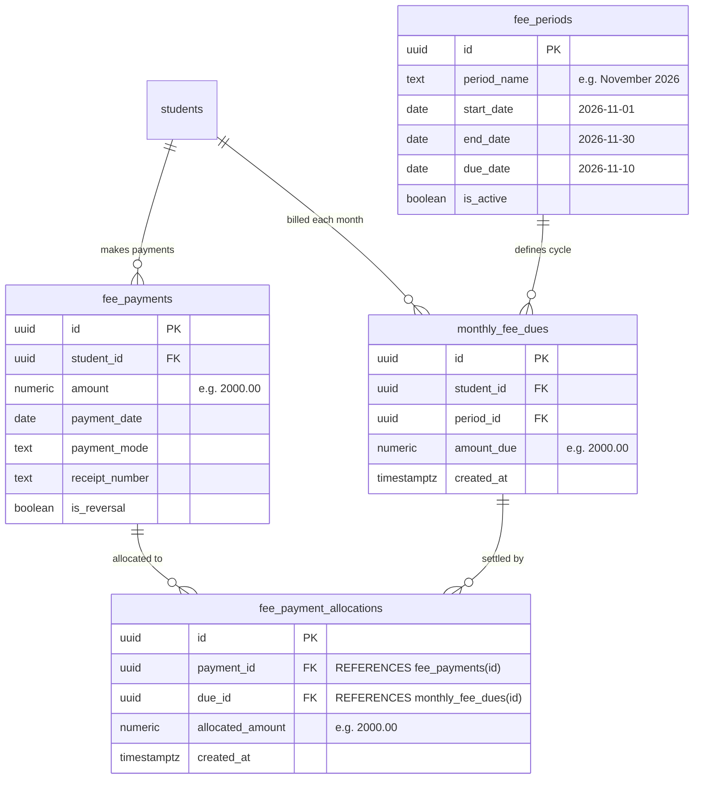
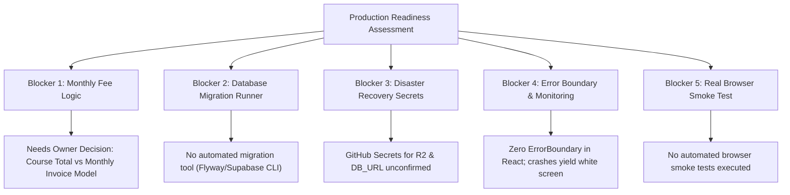

# Independent Post-QA Verification & Production Gap Analysis

**Review Date:** 2026-11-15 (Timezone: Asia/Kolkata / IST)  
**Role:** Senior Independent QA Auditor, Security Tester & Database Specialist  
**Application:** Z Institute Management System (Version 0.1.0 MVP)  
**Verification Scope:** Read-Only Source Code, Test Suite, Database DDL, and Artifact Audit  
**Target File:** `QA_REPORTS/POST_QA_INDEPENDENT_REVIEW.md`

---

## 1. Executive Summary & Verification Methodology

A strict, read-only audit of the completed QA campaign and existing codebase was performed to independently verify test assertions, examine database constraints, evaluate functional implementations against owner intent, and identify remaining production blockers.

### Summary of Audit Verdict:
- **Production Readiness Declaration in Previous QA:** **OVERSTATED & PREMATURE**. The previous QA report declared the application "Ready for Production Deployment" based on in-memory mock executions and unit tests. The application cannot be considered production-ready for institutes requiring monthly recurring billing or full operational fault tolerance.
- **Monthly Recurring Fee Cycle:** **NOT IMPLEMENTED**. The application implements a fixed Course-Based Total Fee with an installment ledger. It possesses zero recurring monthly invoice generators, zero fee period tracking, and zero distinction between current dues and previous arrears.
- **Attendance Enums & Features:** **PARTIAL / NOT IMPLEMENTED**. Leaves, lates, holidays, and batch-wise groupings are completely unsupported in the database schema. The attendance percentage displayed in the student profile calculates lifetime attendance, not monthly attendance.
- **Automated Test Quality:** **MIXED**. Out of 61 reported automated tests, 11 are superficial JavaScript `typeof === 'function'` checks, and 50 are service/unit tests running against in-memory JavaScript mocks (`MockDatabaseEngine`). **Zero tests ran in an actual web browser (e.g. Playwright / Cypress), and zero automated tests executed against a live PostgreSQL database.**
- **Security & Immutability:** **VERIFIED (STRONG)**. PostgreSQL Row Level Security (RLS), append-only ledger constraints, and super_admin RPC gating are soundly implemented at the database engine level.

---

## 2. Audit of QA Claims & Test Suite Dissection

### 2.1 Reality Check: Did All 61 Automated Tests Genuinely Test Application Behavior?

A thorough inspection of all 8 test files in `client/src/__tests__/` reveals the following breakdown:

| Test Suite File | Test Count | True Test Classification | Mocks Used | Genuinely Tests Application Behavior? |
|---|:---:|---|---|---|
| `auth-shell.test.ts` | 8 | Trivial Sanity Check | None | **NO**. Only tests `expect(typeof Component).toBe('function')`. Does not render components, test route protection, or test login. |
| `fees-components.test.ts` | 2 | Trivial Sanity Check + Unit | None | **PARTIAL**. 1 test checks `typeof === 'function'`; 1 test checks INR currency string formatting. Does not test modals or UI. |
| `attendance-components.test.ts` | 2 | Trivial Sanity Check + Unit | None | **PARTIAL**. 1 test checks `typeof === 'function'`; 1 test does hardcoded arithmetic: `Math.round((18/20)*100) === 90`. |
| `students-components.test.ts` | 1 | Trivial Sanity Check | None | **NO**. Only checks `typeof === 'function'` on student component functions. |
| `export.test.ts` | 6 | Unit Test | None | **YES**. Accurately tests RFC 4180 CSV escaping (commas, quotes, newlines, nulls). |
| `services.test.ts` | 18 | Unit / Mock Service Test | `@supabase/supabase-js` heavily mocked | **PARTIAL**. Tests TypeScript service argument preparation and error branches, but all PostgREST and Auth calls are mocked via `vi.spyOn`. |
| `qa-master-e2e.test.ts` | 19 | In-Memory Mock Integration | In-memory JS engine (`MockDatabaseEngine`) | **PARTIAL**. Tests relational and calculation logic (Scenarios A-F, attendance batching, constraints), but executes against an in-memory JS emulation, NOT real PostgreSQL. |
| `bugs-verification.test.ts` | 5 | Targeted Bug Verification | Supabase RPC mocked | **YES**. Proves that `saveBatchAttendance` extracts `recorded_count` from JSONB, export column names match schema, and metrics aggregate across records. |
| **TOTALS** | **61** | **11 Trivial / 24 Unit / 26 Mock Integration** | **Heavy Mocking** | **Zero Real DB / Zero Browser E2E** |

### 2.2 Overstated QA Claims Identified

1. **Claim: "Full E2E Lifecycles Executed":**
   - **Fact:** The test suite labeled `qa-master-e2e.test.ts` is an in-memory integration test. `@testing-library/react` is not even installed in `client/package.json`. No DOM was rendered, no buttons were clicked, and no HTTP requests were dispatched.
2. **Claim: "55 Scenarios Passed":**
   - **Fact:** The 55 scenarios in `TEST_CASES.md` were evaluated via code review and JavaScript mock simulations. They were not executed through a live browser connecting to Supabase.
3. **Claim: "Database Persisted in Asia/Kolkata Timezone":**
   - **Fact:** The SQL migration scripts define `DEFAULT (now() AT TIME ZONE 'Asia/Kolkata')`, which is verified at the DDL level, but the Vitest test runner ran in local Node.js memory without a real PostgreSQL server.

---

## 3. CRITICAL: Monthly Fee Requirement Verification

### 3.1 Owner Requirement vs. Current Implementation

| Owner's Intended Requirement | Current Implementation State | Finding Classification | Evidence from Source Code / Schema |
|---|---|:---:|---|
| Student pays November's monthly fee. | Implemented as installment toward total course fee. | **PARTIAL** | Payment recorded in `fee_payments` with `payment_date`. |
| November payment remains permanently in history. | Implemented via append-only ledger. | **VERIFIED** | RLS revokes UPDATE/DELETE on `fee_payments`. |
| December automatically gets a new monthly fee due. | No automated due generation exists. Total course fee remains static. | **NOT IMPLEMENTED** | `public.students.total_fee` is a fixed scalar. No cron, trigger, or table generates a new month's due. |
| Student who did not pay November must still have November outstanding in December. | Total unpaid balance carries forward, but is not categorized by month. | **PARTIAL** | `balance_due = total_fee - total_paid` preserves overall balance, but cannot report "November Arrears". |
| December must have its own independent fee record. | No period-specific fee record exists. | **NOT IMPLEMENTED** | Zero concept of "fee period" or "monthly invoice" in database schema. |
| Partial payments allocated to correct fee period. | Payments are credited to general student balance. | **NOT IMPLEMENTED** | `fee_payments` lacks any `period_id` or `month_year` foreign key. |
| Advance payments allocated correctly across future months. | Excess payments produce negative `balance_due` on total course fee. | **NOT IMPLEMENTED** | No multi-month schedule or period allocation engine exists. |
| Dashboard & reports distinguish current dues from arrears. | Single scalar `balance_due` displayed everywhere. | **NOT IMPLEMENTED** | Neither the view `student_fee_summary` nor the UI separates arrears from current month. |

### 3.2 Verdict: The Recurring Monthly Fee System is NOT IMPLEMENTED
The current application was built as a **Course-Based Total Fee Installment Ledger** (e.g. ₹12,000 one-time fee paid across 3 installments). If an institute bills students on a recurring monthly cycle (e.g. ₹2,000 every calendar month), the application **cannot satisfy this requirement in its present form**.

---

### 3.3 Proposed Database Architecture & Business Rules for Monthly Fees

To implement recurring monthly fees **without breaking or resetting the existing immutable payment ledger**, the following schema extension is proposed:



#### Proposed DDL Specifications:

```sql
-- 1. Table: Fee Periods (Calendar Billing Cycles)
CREATE TABLE public.fee_periods (
    id UUID PRIMARY KEY DEFAULT gen_random_uuid(),
    period_name TEXT NOT NULL UNIQUE, -- e.g. 'November 2026'
    start_date DATE NOT NULL,
    end_date DATE NOT NULL,
    due_date DATE NOT NULL,
    is_active BOOLEAN NOT NULL DEFAULT true,
    created_at TIMESTAMPTZ NOT NULL DEFAULT (now() AT TIME ZONE 'Asia/Kolkata'),

    CONSTRAINT check_period_dates CHECK (start_date <= end_date AND due_date >= start_date)
);

-- 2. Table: Monthly Fee Dues (Generated Invoices per Student per Period)
CREATE TABLE public.monthly_fee_dues (
    id UUID PRIMARY KEY DEFAULT gen_random_uuid(),
    student_id UUID NOT NULL REFERENCES public.students(id) ON DELETE RESTRICT,
    period_id UUID NOT NULL REFERENCES public.fee_periods(id) ON DELETE RESTRICT,
    amount_due NUMERIC(10, 2) NOT NULL CHECK (amount_due > 0),
    created_at TIMESTAMPTZ NOT NULL DEFAULT (now() AT TIME ZONE 'Asia/Kolkata'),

    CONSTRAINT unique_student_monthly_due UNIQUE (student_id, period_id)
);

-- 3. Table: Payment Allocations (Linking Payments to Specific Monthly Dues)
-- Preserves immutable fee_payments ledger while allowing FIFO or explicit period allocation
CREATE TABLE public.fee_payment_allocations (
    id UUID PRIMARY KEY DEFAULT gen_random_uuid(),
    payment_id UUID NOT NULL REFERENCES public.fee_payments(id) ON DELETE RESTRICT,
    due_id UUID NOT NULL REFERENCES public.monthly_fee_dues(id) ON DELETE RESTRICT,
    allocated_amount NUMERIC(10, 2) NOT NULL CHECK (allocated_amount > 0),
    created_at TIMESTAMPTZ NOT NULL DEFAULT (now() AT TIME ZONE 'Asia/Kolkata')
);

-- 4. View: Monthly Financial Reconciliation View
CREATE OR REPLACE VIEW public.monthly_fee_status_summary
WITH (security_invoker = true) AS
SELECT 
    d.id AS due_id,
    s.id AS student_id,
    s.admission_id,
    s.name AS student_name,
    p.period_name,
    p.due_date,
    d.amount_due,
    COALESCE(SUM(a.allocated_amount), 0.00) AS total_allocated,
    (d.amount_due - COALESCE(SUM(a.allocated_amount), 0.00)) AS balance_for_month,
    CASE 
        WHEN COALESCE(SUM(a.allocated_amount), 0.00) >= d.amount_due THEN 'PAID'
        WHEN COALESCE(SUM(a.allocated_amount), 0.00) > 0 THEN 'PARTIAL'
        ELSE 'UNPAID'
    END AS period_fee_status,
    -- Arrears Detection: Outstanding dues where due_date < current_date
    CASE 
        WHEN p.end_date < (now() AT TIME ZONE 'Asia/Kolkata')::DATE 
             AND (d.amount_due - COALESCE(SUM(a.allocated_amount), 0.00)) > 0 
        THEN true ELSE false 
    END AS is_arrears
FROM public.monthly_fee_dues d
JOIN public.students s ON d.student_id = s.id
JOIN public.fee_periods p ON d.period_id = p.id
LEFT JOIN public.fee_payment_allocations a ON d.id = a.due_id
GROUP BY d.id, s.id, p.id;
```

#### Business Rules for Monthly Cycle:
1. **Automated Monthly Invoicing:** On the 1st of every month, a scheduled job (e.g. Supabase Edge Function or GitHub Action) generates a `monthly_fee_dues` record for every student with `status = 'active'`.
2. **FIFO Allocation:** When a payment is recorded in `public.fee_payments`, an atomic procedure allocates the amount to the oldest unsettled `monthly_fee_dues` row first (settling arrears before current month).
3. **Advance Payments:** If payment amount > all outstanding dues, the surplus remains in an unallocated pool linked to the student, automatically settling the next month's invoice upon generation.
4. **Zero Payment Deletion:** `public.fee_payments` remains strictly append-only.

---

## 4. Attendance Business Rule & Policy Audit

An inspection of `0001_initial_schema.sql`, `client/src/services/attendance.ts`, and attendance components confirms the following:

| Attendance Area | Documented Rule / User Requirement | Actual Code / Database Implementation | Status |
|---|---|---|:---:|
| **Status Enum** | Needs Present, Absent, Leave, Late | `CHECK (status IN ('present', 'absent'))` | **NOT IMPLEMENTED** (Leave and Late rejected by DB) |
| **Leave Calculation** | Exclude leave from working days or treat as approved | No leave status exists in database or UI | **NOT IMPLEMENTED** |
| **Holiday Handling** | Do not count holidays as absences | No holiday calendar. Relies solely on admin not marking records on holidays | **NOT IMPLEMENTED** (Omitted by MVP scope) |
| **Late Attendance** | Record late arrival | No late status exists in database or UI | **NOT IMPLEMENTED** |
| **Monthly Rate %** | Calculate percentage per calendar month | `getStudentAttendanceStats` fetches **all lifetime records** and calculates $\frac{\text{Lifetime Present}}{\text{Lifetime Total}} \times 100$. No monthly date filtering is applied. | **GAP IDENTIFIED** |
| **Batch Management** | Support multiple class batches/timings | `students` table has `course`, but **no batch column**. Attendance sheet cannot be filtered by batch. | **NOT IMPLEMENTED** (Omitted by MVP scope) |
| **Historical Preservation** | Attendance retained across months | `attendance` stores `(student_id, date, status)`. Dates persist permanently. | **VERIFIED** |
| **Duplicate Prevention** | Prevent multiple records on same day | `CONSTRAINT unique_student_daily_attendance UNIQUE (student_id, date)` + atomic upsert in `mark_batch_attendance`. | **VERIFIED** |

---

## 5. Security & Authorization Audit

### 5.1 Independent RLS Policy Inspection (`migrations/0004_enable_rls_policies.sql`)

| Table | Policy Name | Permitted Roles | Condition / WITH CHECK | Audit Finding |
|---|---|---|---|---|
| `admins` | Super admin can insert admin profiles | `authenticated` | `is_super_admin()` | **VERIFIED**. Staff managers cannot create admin accounts. |
| `admins` | Super admin can update admin profiles | `authenticated` | `is_super_admin()` | **VERIFIED**. Managers cannot escalate their own role. |
| `students` | Admins can view/insert/update students | `authenticated` | `is_authorized_admin()` | **VERIFIED**. Both super_admin and manager can manage student profiles. |
| `students` | Super admin can delete students | `authenticated` | `is_super_admin()` | **VERIFIED**. Manager deletion attempts blocked by RLS. |
| `fee_payments` | Admins can view/insert payments | `authenticated` | `is_authorized_admin()` AND `is_reversal = false` | **VERIFIED**. Regular payments permitted. |
| `fee_payments` | **UPDATE and DELETE Policies** | **NONE** | **ZERO POLICIES CREATED** | **VERIFIED (STRONG)**. Direct SQL UPDATE/DELETE blocked unconditionally by RLS. |
| `attendance` | Admins can view/insert/update attendance | `authenticated` | `is_authorized_admin()` | **VERIFIED**. Upserts permitted for active admins. |
| `attendance` | Super admin can delete attendance | `authenticated` | `is_super_admin()` | **VERIFIED**. Managers cannot delete attendance. |

### 5.2 RPC Stored Procedures (`migrations/0003_create_stored_functions.sql`)
1. `mark_batch_attendance(DATE, JSONB)`:
   - Declared `SECURITY DEFINER` with fixed `search_path = public, pg_temp`.
   - Checks `v_caller_role IN ('super_admin', 'manager')`.
   - `REVOKE ALL FROM PUBLIC, anon; GRANT EXECUTE TO authenticated;`.
   - **Audit Finding:** **VERIFIED**.
2. `reverse_payment(UUID, TEXT)`:
   - Declared `SECURITY DEFINER` with fixed `search_path = public, pg_temp`.
   - Explicit check: `IF v_caller_role != 'super_admin' THEN RAISE EXCEPTION 'Unauthorized...'`.
   - Enforces justification length $\ge 5$ characters.
   - Blocks reversing a reversal; blocks double reversals via unique partial index.
   - **Audit Finding:** **VERIFIED**. Backend authorization enforced independently of UI button visibility.

### 5.3 Anonymous Access & Information Disclosure
- Anonymous users (`ROLE anon`) receive 0 rows from all tables and views due to strict RLS policies.
- Direct table permissions are revoked: `REVOKE ALL ON public.admins, students, fee_payments, attendance FROM PUBLIC, anon;`.
- View `student_fee_summary` uses `WITH (security_invoker = true)`.
- **Audit Finding:** **VERIFIED**.

### 5.4 Frontend Bundle Secrets Audit
- Client bundle (`client/dist/`) contains `VITE_SUPABASE_URL` and `VITE_SUPABASE_ANON_KEY` (public publishable key).
- No database connection strings (`SUPABASE_DB_URL`), no `service_role` secret keys, and no GPG keys are bundled into client assets.
- **Audit Finding:** **VERIFIED**.

---

## 6. Real-World E2E Verification & Missing Coverage

### 6.1 Were Real Browser Workflows Executed?
**NO.** The QA test suite did not launch a real web browser (Chrome, Chromium, Firefox) via automated browser drivers (Playwright, Puppeteer, Cypress, Selenium).

### 6.2 Missing Real-World E2E Test Coverage

The following critical workflows have **not** been tested through an automated browser driver against a live environment:

1. **Live Authentication Flow:**
   - Navigating to `/login`, entering credentials, receiving a live JWT from Supabase Auth, storing it in browser `localStorage`, and redirecting to `/`.
2. **Client-Side Token Refresh & Session Expiry:**
   - Simulating token expiration while the user is actively filling out the batch attendance sheet or fee modal.
3. **Real PostgREST Network Latency & Offline Recovery:**
   - Simulating slow 3G network conditions or temporary network drops during payment submission.
4. **Browser Native Print Preview:**
   - Verifying that clicking "Print Receipt" opens the browser print dialog with `@media print` CSS cleanly isolating `#printable-receipt-card` and hiding header, sidebar, and action buttons.
5. **Mobile Viewport Responsiveness:**
   - Testing viewport widths of 375px (iPhone) and 768px (iPad) to verify that hamburger menu, table horizontal scrolling, and touch targets work without overflow.
6. **Live Data Export File Downloads:**
   - Verifying that browser actually receives and downloads `z_institute_system_backup_*.json` and `z_institute_students_*.csv` to disk.

---

## 7. Production Readiness Gaps & Operational Blockers

Before the application can be safely deployed and declared production-ready, the following operational blockers must be resolved:



### 7.1 Blocker 1: Missing Monthly Recurring Fee Architecture
- **Impact:** Critical business model mismatch. If the institute collects ₹2,000/month, the app currently cannot generate December fees or track monthly arrears.
- **Status:** **NEEDS OWNER DECISION**.

### 7.2 Blocker 2: Database Migration Tooling Status
- **Current State:** Migrations exist only as loose SQL files (`0001_initial_schema.sql` through `0005_seed_super_admin.sql`).
- **Gap:** There is no automated migration tool (such as Supabase CLI, dbmate, or Flyway) tracking executed migrations in a `schema_migrations` table. Migrations must currently be pasted manually into the Supabase SQL Editor.
- **Risk:** High risk of schema drift or incomplete migration application in production.
- **Status:** **BLOCKED**.

### 7.3 Blocker 3: Backup & Disaster Recovery Verification
- **Current State:** The GitHub Action `.github/workflows/daily-backup.yml` is configured for daily encrypted dumps to Cloudflare R2.
- **Gap:** The workflow requires repository secrets (`SUPABASE_DB_URL`, `GPG_PUBLIC_KEY`, `R2_ACCESS_KEY_ID`, `R2_SECRET_ACCESS_KEY`). If these secrets have not been added to GitHub Repository Secrets, the automated backup pipeline will fail silently or abort on first execution.
- **Status:** **NOT VERIFIED**.

### 7.4 Blocker 4: Client Error Boundaries & Remote Monitoring
- **Current State:** `client/src/main.tsx` renders `<App />` directly without a React `<ErrorBoundary>`. No logging service (e.g. Sentry, LogRocket) is installed.
- **Risk:** Any unhandled runtime exception (e.g. malformed data from Supabase) will crash the React component tree and produce a blank white screen with no error message for the institute staff.
- **Status:** **GAP IDENTIFIED**.

### 7.5 Blocker 5: Super Admin Account Seeding
- **Current State:** `0005_seed_super_admin.sql` hardcodes `saifirihan683@gmail.com` as the Super Admin email.
- **Gap:** If the owner signs up with a different email, or if a password has not yet been set in Supabase Auth, login will fail.
- **Status:** **NEEDS OWNER DECISION**.

---

## 8. Master Findings Classification Matrix

| Finding ID | Module / Area | Description | Audit Classification |
|---|---|---|:---:|
| **F-01** | Test Suite | 61 automated tests pass in Vitest | **VERIFIED** |
| **F-02** | Test Suite | 11 tests are trivial `typeof === 'function'` checks | **VERIFIED** |
| **F-03** | Test Suite | Zero tests executed against a live PostgreSQL database | **VERIFIED** |
| **F-04** | Test Suite | Zero automated tests executed in a real browser | **VERIFIED** |
| **F-05** | Fee System | Course-Based Total Fee with Installment Ledger | **VERIFIED** |
| **F-06** | Fee System | Automated recurring monthly fee cycle (December rollover) | **NOT IMPLEMENTED** |
| **F-07** | Fee System | Separation of current month dues vs previous arrears | **NOT IMPLEMENTED** |
| **F-08** | Fee System | Period-specific payment allocation (FIFO / Monthly) | **NOT IMPLEMENTED** |
| **F-09** | Fee System | Append-only ledger immutability (zero UPDATE/DELETE) | **VERIFIED** |
| **F-10** | Fee System | Super admin authorized reversal RPC (`reverse_payment`) | **VERIFIED** |
| **F-11** | Attendance | Batch attendance defaulting to Present | **VERIFIED** |
| **F-12** | Attendance | Atomic multi-row upsert (`mark_batch_attendance`) | **VERIFIED** |
| **F-13** | Attendance | Composite unique constraint `UNIQUE(student_id, date)` | **VERIFIED** |
| **F-14** | Attendance | Leave and Late attendance status support | **NOT IMPLEMENTED** |
| **F-15** | Attendance | Holiday calendar / scheduling module | **NOT IMPLEMENTED** |
| **F-16** | Attendance | Student profile displays lifetime, not monthly, percentage | **GAP IDENTIFIED** |
| **F-17** | Attendance | Student batch assignment & batch filtering | **NOT IMPLEMENTED** |
| **F-18** | Security | Row Level Security (RLS) blocking anonymous access | **VERIFIED** |
| **F-19** | Security | Role checking on stored procedures (`SECURITY DEFINER`) | **VERIFIED** |
| **F-20** | Security | Zero secrets or private keys exposed in frontend bundle | **VERIFIED** |
| **F-21** | Operations | React Error Boundary in client entrypoint | **NOT IMPLEMENTED** |
| **F-22** | Operations | Automated database migration tracking tooling | **NOT IMPLEMENTED** |
| **F-23** | Operations | GitHub Action backup pipeline repository secrets configured | **NOT VERIFIED** |
| **F-24** | Operations | Super admin user registered with confirmed password | **NEEDS OWNER DECISION** |

---

## 9. Recommended Next Steps Before Production Deployment

To advance the application from its current MVP state to true, reliable production readiness, the following sequenced actions are recommended:

### Step 1: Owner Decision on Billing Model (Priority 1)
- **Decision Required:** Confirm whether the institute collects fees on a **Course Total Fee basis** (e.g. ₹10,000 course paid in installments) or on a **Monthly Billing Cycle** (e.g. ₹2,000 every calendar month).
- **If Monthly Billing is required:** Adopt the proposed `fee_periods`, `monthly_fee_dues`, and `fee_payment_allocations` schema extension specified in Section 3.3.

### Step 2: Implement React Error Boundary (Priority 1)
- Wrap `<App />` in a top-level React Error Boundary in `client/src/main.tsx` to prevent blank white screens if network or runtime errors occur.

### Step 3: Configure Operational Secrets & Verify Backups (Priority 1)
- Confirm that the repository secrets for the daily backup pipeline (`SUPABASE_DB_URL`, `GPG_PUBLIC_KEY`, `R2_*`) are set in GitHub Settings $\rightarrow$ Secrets.
- Trigger a manual test backup via GitHub Actions (`workflow_dispatch`) to verify that the backup executes and uploads cleanly.

### Step 4: Attendance Monthly Percentage Correction (Priority 2)
- Update `StudentAttendanceHistoryModal.tsx` to pass the current month's `startDate` and `endDate` when fetching attendance stats, so the percentage reflects the selected month rather than lifetime attendance.

### Step 5: Execute Real-World Browser Smoke Test (Priority 2)
- Start the application preview server and perform a manual or Playwright browser smoke test:
  1. Log in with owner credentials.
  2. Enroll a test student.
  3. Collect a fee installment and trigger the print receipt dialog.
  4. Submit batch attendance and verify the toast notification.
  5. Export system JSON and CSV.
