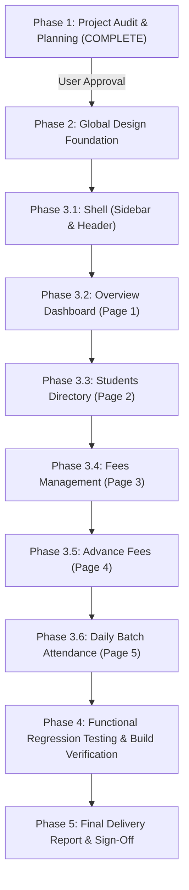

# Z INSTITUTE MANAGEMENT SYSTEM — UI/UX REDESIGN AUDIT (PHASE 1)
**Document Version:** 1.0.0  
**Audit Date:** 16 November 2026  
**Scope:** Frontend UI/UX Redesign & Visual System Modernization  
**Governance:** Strict UI-Only Transformation • Zero Functional Regression • Backend & Database Untouched  

---

## 1. Executive Summary

This audit establishes the baseline architectural, functional, and visual inventory of the **Z Institute Management System** frontend (`client/`). The goal is a visual transformation aligned with the provided reference designs:
1. **Reference 1:** Daily Batch Attendance Dashboard (rich gradient banner, stat pills, pill filter bar, rounded card table with attendance toggles/badges).
2. **Reference 2:** Overview Dashboard + Student Management (navy blue sidebar with bottom wave graphics, top navbar with role badge & user dropdown, royal blue gradient hero banner with 3D education illustration, 4 KPI cards with sparkline curves, and full Students Management section with search, course dropdown, + Add Student button, and styled data table).
3. **Reference 3:** Monthly Fees Collection Dashboard (banner with billing period pill, wallet 3D illustration, generate dues & export actions, 5 fee KPI cards, month filter tabs, and full month-wise status table with collect actions).

In accordance with the **Strict Non-Negotiable Rules**, this redesign will **strictly touch presentation and styling**. All Supabase queries, RPC calls, business logic, calculations, ledger immutability constraints, outbox mechanics, authentication, and routing remain 100% unaltered.

---

## 2. Project Architecture & Technology Stack

| Layer | Technology | Version | Purpose in Application |
| :--- | :--- | :--- | :--- |
| **Framework** | React | `18.3.1` | Core UI component tree |
| **Routing** | React Router DOM | `6.28.0` | Client-side routing (`BrowserRouter`, `Routes`, `Route`, `Navigate`) |
| **Styling** | Tailwind CSS | `3.4.16` | Utility-first styling engine (`tailwind.config.js`, `postcss.config.js`) |
| **Iconography** | Lucide React | `0.468.0` | Consistent vector iconography |
| **Backend Integration** | `@supabase/supabase-js` | `2.48.1` | Supabase Auth, PostgreSQL tables, views, and RPC execution |
| **Build Tooling** | Vite | `6.0.7` | Fast HMR and production bundler (`tsc && vite build`) |
| **Type Checking** | TypeScript | `5.7.2` | Strict compile-time safety (`tsconfig.json`) |
| **Test Suite** | Vitest | `2.1.8` | 12 test suites, 119 unit/integration tests (`npm test`) |

---

## 3. Application Routes & Page Inventory

| Route Path | Page Component | Access Level | Description & Core Purpose |
| :--- | :--- | :--- | :--- |
| `/login` | `Login.tsx` | Public | Email/password authentication into Supabase Auth with institute logo. |
| `/` | `DashboardOverview.tsx` | Protected | Institute overview: hero banner, KPI statistics, quick navigation, security callouts, student table. |
| `/students` | `StudentsPage.tsx` | Protected | Student admissions directory: paginated student list, search, course & status filters, admission/edit/delete modals. |
| `/fees` | `FeesPage.tsx` | Protected | Granular month-by-month fee collection: billing periods, KPI dues metrics, on-demand dues generation, CSV export, collection modal, payment history modal, printable receipt. |
| `/advance-fees` | `AdvanceFeesPage.tsx` | Protected | Advance fee management: escrow tracking, monthly fee ceiling verification, pre-payment recording, Super Admin voiding modal, printable advance receipt. |
| `/attendance` | `AttendancePage.tsx` | Protected | Daily batch attendance: calendar date picker, live percentage pills, batch search & course filters, locked confirmed badges / interactive toggles, atomic upsert commit, attendance history modal. |
| `*` | `Navigate to="/"` | Any | Fallback wildcard redirecting unauthenticated or unknown paths to root. |

---

## 4. Component Inventory & Functional Boundary Analysis

### A. Layout & Shell Components
1. **`DashboardLayout.tsx`** (`components/layout/`):
   - **Current Structure:** Wraps all protected routes with `Sidebar` and `Header` around an `<Outlet />`. Manages mobile menu toggle state (`isMobileMenuOpen`).
   - **Redesign Target:** Update main content wrapper to the soft ice-blue/grey background (`#F3F7FE` / `bg-[#F3F7FE]`), ensure seamless desktop padding, and maintain responsive sidebar drawer behavior.
   - **Regression Risk:** Low (pure layout container).

2. **`Sidebar.tsx`** (`components/layout/`):
   - **Current Structure:** 64px width, dark slate (`bg-slate-900`), 5 navigation links (`/`, `/students`, `/fees`, `/advance-fees`, `/attendance`), connection status pill at bottom.
   - **Redesign Target:** Transform into premium deep navy (`#07183D` / `#061A3D`), add institute graduation cap shield logo with glowing accents, section header "MAIN MENU", active link with vibrant blue gradient pill (`#0866F5`), subtle wave SVG graphics at bottom, and connection indicator ("● Supabase Connected" + "v1.0.0 • MVP Edition").
   - **Regression Risk:** Low (pure navigation presentation).

3. **`Header.tsx`** (`components/layout/`):
   - **Current Structure:** 64px height, white background, mobile toggle, institute title, Export button, user avatar, role label, sign out button.
   - **Redesign Target:** Match Reference 1 & 2: sleek white navbar, Institute title and branding, in-app `Export` pill button, Super Admin pill badge (`👑 Super Admin`), user avatar with name (`Rihan` / `saifirihan683@gmail.com`) and dropdown trigger, and clean `Sign Out` action.
   - **Regression Risk:** Low.

---

### B. Overview Dashboard Components
1. **`DashboardOverview.tsx`** (`pages/`):
   - **Current Structure:** Hero banner with sparkles, 3 quick module links, data portability banner, and security info card.
   - **Reference 2 Alignment:**
     - **Welcome Hero Banner:** Royal blue gradient (`#0866F5` to `#3B82F6`), date badge pill (`[📅 Monday, 15 Nov 2026]`), "Welcome back, Rihan! 👋", descriptive subtitle, and 3D education illustration (books stack with graduation cap and subtle star accents).
     - **4 Stat Summary Cards:**
       1. *Total Students:* Icon in soft blue circle, large count `4`, green badge `↑ +1`, background curve.
       2. *Collected Fees:* Icon in soft emerald circle, large amount `₹3,500`, green badge `↑ +12%`, background curve.
       3. *Pending Fees:* Icon in soft amber circle, large amount `₹1,500`, orange badge `↑ +0%`, background curve.
       4. *This Month:* Icon in soft purple circle, large amount `₹2,000`, purple badge `↑ +8%`, background curve.
     - **Students Management Section:** Directly render student management table with search, course dropdown, + Add Student button, and paginated table with avatars and action buttons.
     - **Preservation:** Connect directly to existing data sources (`getStudents`, `getMonthlyDues`, `adminProfile`) without fabricating numbers.
   - **Regression Risk:** Medium (requires seamless data integration with real student counts and fee ledger totals).

---

### C. Students Management Components
1. **`StudentsPage.tsx`** (`pages/`):
   - **Current Structure:** Full student directory with filters, table, and 3 modals (`AddStudentModal`, `EditStudentModal`, `DeleteStudentModal`).
   - **Redesign Target:** Integrate page header banner with student illustration, modern rounded filter card with search and course dropdown, styled student data table matching Reference 2.
   - **Regression Risk:** Low.

2. **`StudentFilters.tsx`** & **`StudentTable.tsx`** (`components/students/`):
   - **Current Structure:** Search bar, course select, status tabs, table with columns: Admission ID, Student Name, Phone, Course, Joining Date, Monthly Fee, Status, Actions.
   - **Redesign Target:**
     - Table header: Soft ice-blue background (`bg-[#F0F5FF]`), bold dark navy uppercase headers.
     - Rows: Student letter avatar (colored circular badges `M`, `S`, `R`), phone with icon, course with icon/badge, joining date with calendar icon, monthly fee in bold INR currency, status pill badge with green dot (`● Active`), rounded action buttons (View, Edit, Delete).
     - Modern pagination footer: "Showing 1-4 of 4 students", `< 1 >` pagination pills.
   - **Regression Risk:** Low (pure styling).

3. **Student Modals** (`AddStudentModal.tsx`, `EditStudentModal.tsx`, `DeleteStudentModal.tsx`):
   - **Current Structure:** Viewport-capped (`max-h-[88vh]`), sticky header/footer, phone validation (`/^[6-9]\d{9}$/`), escape key dismissal.
   - **Redesign Target:** Upgrade styling to modern design system: soft shadows, refined inputs, blue gradient submit buttons.
   - **Regression Risk:** Very Low.

---

### D. Fees Management Components
1. **`FeesPage.tsx`** (`pages/`):
   - **Current Structure:** Month-by-month dues collection, period dropdown, generate dues trigger, export CSV, 5 metrics cards, dues table, payment modal, history modal, receipt modal.
   - **Reference 2 / 3 Alignment:**
     - **Hero Banner:** Blue gradient banner with billing period pill (`[📅 November 2026]`), title "Monthly Fees Collection", subtitle, 3D wallet illustration with coins, inline action buttons (`🔄 Generate Month Dues` and `📥 Export Month CSV`).
     - **5 KPI Summary Cards:**
       1. *Expected Dues:* Blue card with receipt icon, large formatted amount, subtitle.
       2. *Advance Adjusted:* Amber card with wallet icon, amount, subtitle.
       3. *Direct Collections:* Emerald card with bank icon, amount, subtitle.
       4. *Remaining Dues:* Rose card with calendar icon, amount, subtitle.
       5. *Unpaid Students:* Purple card with users icon, count, subtitle.
     - **Search & Status Filter Bar:** Rounded card with search input, status pills (`All Months`, `UNPAID`, `PARTIAL`, `PAID`).
     - **Table Styling:** Light blue table header (`bg-[#F0F5FF]`), dark navy headers, student initial avatar, course badge, fee snapshot, advance offset, paid amount, remaining balance, status pill (`● PAID` in green, `● UNPAID` in rose), primary blue `Collect` button with credit card icon + history clock icon button.
   - **Regression Risk:** Low (preserves all existing RPC and calculation logic).

2. **Fee Modals & Receipts** (`RecordMonthlyPaymentModal.tsx`, `RecordAdvanceModal.tsx`, `VoidAdvanceModal.tsx`, `PrintableMonthlyReceipt.tsx`, `PrintableAdvanceReceipt.tsx`, `PaymentHistoryModal.tsx`):
   - **Current Structure:** Viewport-capped, non-overflowing, sticky header/footer, Indian currency formatting.
   - **Redesign Target:** Apply polished design tokens: refined borders, clean typography, consistent blue primary action buttons, maintaining current compact sizing (`max-w-xl`, `max-h-[82vh]`).
   - **Regression Risk:** Low.

---

### E. Batch Attendance Components
1. **`AttendancePage.tsx`** & **`AttendanceDateBar.tsx`** (`pages/` & `components/attendance/`):
   - **Reference 1 Alignment:**
     - **Hero Banner:** Blue gradient banner with calendar icon in white rounded square, title "Daily Batch Attendance", subtitle "Mark student class attendance in seconds with batch filtering and atomic updates", 3D clipboard illustration with checkmarks and clock.
     - **Date Bar & Live Metric Counter Pills:**
       - Date picker input: `[📅 16-11-2026 ⌵]`.
       - Quick date filter pills: `Today` (active blue pill), `Yesterday`, `Last 7 Days`, `This Month`.
       - Metric counter pills: `Active: 4` (blue pill), `Present: 4` (green pill), `Absent: 0` (rose pill), `100% Attendance` (purple pill).
     - **Filter & Master Action Toolbar:**
       - Search bar: `Search by student name...`
       - Course filter dropdown: `All Courses ⌵`
       - Batch filter dropdown: `All Batches ⌵`
       - Status tab pills: `Present (4)`, `Absent (0)`
       - Master Action Buttons: `✓ Mark All Present` (emerald button), `✕ Mark All Absent` (rose button) or locked state with `Edit Attendance`.
   - **Regression Risk:** Low.

2. **`BatchAttendanceSheet.tsx`** (`components/attendance/`):
   - **Reference 1 Alignment:**
     - Light blue table header (`bg-[#F0F5FF]`), dark navy column titles (`ADMISSION ID`, `STUDENT NAME`, `COURSE`, `STATUS`, `HISTORY`).
     - Admission ID in soft light-blue badge (`Z-4`, `Z-3`, etc.).
     - Student name in bold dark text.
     - Course with relevant icon (`💻 full stack`, `🐍 python programming`, `🖥️ Basic`, `</> web dev`).
     - Status column:
       - In interactive mode: green `✓ Present` toggle / red `✕ Absent` toggle.
       - In locked mode (saved attendance): confirmed badges `✓ Present` / `✕ Absent`.
     - History column: `🕒 History` button.
     - Sticky bottom bar: Total students, Present, Absent counters, and blue `Save Attendance` button with disk icon.
   - **Regression Risk:** Low (preserves atomic batch upsert RPC and lock/unlock logic).

3. **Attendance Modals** (`AttendanceReviewModal.tsx`, `StudentAttendanceHistoryModal.tsx`):
   - **Current Structure:** Review modal before save, student attendance history modal with percentage ring.
   - **Redesign Target:** Align fonts, card radii, and button colors with the global design system.
   - **Regression Risk:** Very Low.

---

### F. Common / Auxiliary Components
1. **`DataExportModal.tsx`** (`components/common/`):
   - **Current Structure:** Viewport-capped (`max-h-[90vh]`), 6 export options (JSON backup, students CSV, fee payments CSV, monthly dues CSV, advance deposits CSV, attendance history CSV).
   - **Redesign Target:** Polish cards, icons, and download buttons to match the global theme.
   - **Regression Risk:** Very Low.

2. **`Login.tsx`** (`pages/`):
   - **Current Structure:** Clean authentication form for Supabase Auth.
   - **Redesign Target:** Upgrade with deep navy background or clean gradient backdrop, institute graduation cap shield logo, sleek inputs, and royal blue login button.
   - **Regression Risk:** Very Low.

---

## 5. Global Design System Specifications

### A. Color Palette Design Tokens
```css
/* Core Primary & Surfaces */
--color-primary-blue: #0866F5;       /* Vivid SaaS Royal Blue */
--color-primary-blue-hover: #0654ce;
--color-deep-navy: #07183D;          /* Sidebar & Heading Navy */
--color-sidebar-bg: #061A3D;         /* Dark Navy Sidebar */
--color-page-bg: #F3F7FE;            /* Clean Ice-Blue Page Background */
--color-card-bg: #FFFFFF;            /* Pure White Card Surfaces */

/* Typography */
--color-text-primary: #10234F;       /* High-contrast Navy Headings */
--color-text-secondary: #64748B;     /* Muted Slate Body/Labels */
--color-text-muted: #94A3B8;         /* Subdued Captions/Borders */

/* Semantic States */
--color-success: #10B981;            /* Emerald (Active / Paid / Present) */
--color-success-bg: #ECFDF5;
--color-danger: #EF4444;             /* Rose (Unpaid / Absent / Delete) */
--color-danger-bg: #FEF2F2;
--color-warning: #F59E0B;            /* Amber (Pending / Warning / Offset) */
--color-warning-bg: #FFFBEB;
--color-purple: #7047EB;             /* Purple (Percentages / Highlights) */
--color-purple-bg: #F5F3FF;
```

### B. Typography
- **Font Family:** `Inter`, `-apple-system`, `BlinkMacSystemFont`, `"Segoe UI"`, `Roboto`, `sans-serif`.
- **Hero Headings:** `text-2xl sm:text-3xl font-extrabold tracking-tight`.
- **Section Titles:** `text-base sm:text-lg font-bold text-[#10234F]`.
- **Table Headers:** `text-[11px] font-bold uppercase tracking-wider text-[#10234F]`.
- **Card Metrics:** `text-xl sm:text-2xl font-black text-slate-900`.
- **Micro-copy / Badges:** `text-[10px] sm:text-[11px] font-semibold`.

### C. Border Radius & Shadows
- **Card Containers:** `rounded-2xl` (~16px to 20px).
- **Hero Banners:** `rounded-2xl sm:rounded-3xl` (~20px to 24px).
- **Buttons & Pills:** `rounded-xl` (~10px to 14px) or `rounded-full` for status pills.
- **Form Inputs:** `rounded-xl` (~10px to 12px).
- **Shadows:** Soft diffuse shadows (`shadow-xs`, `shadow-sm`, `shadow-md`, custom `0 4px 20px -2px rgba(8, 102, 245, 0.08)`).

### D. 3D & Vector Asset Strategy
To avoid external network dependencies, broken image links, or CDN latency, all 3D illustrations (graduation books, finance wallet, attendance clipboard) and background wave sparklines will be implemented as **pure, self-contained SVG vectors and CSS gradients** embedded directly in the components. This guarantees 100% offline reliability, instant rendering, and zero build warnings.

---

## 6. Functional Safety & Regression Prevention Matrix

| Component / Workflow | Business Rule / Invariant | Redesign Protection Measure |
| :--- | :--- | :--- |
| **Authentication & Role Guard** | `useAuth()`, `adminProfile`, `role === 'super_admin'` controls privileged actions (e.g. void advance). | Keep all permission checks, logout handlers, and role-based conditional rendering identical. Only update visual styling. |
| **Monthly Fee Calculations** | Individual snapshots (`fee_snapshot`), direct collections (`normal_paid_amount`), advance adjustments (`advance_applied_amount`). | Do not alter mathematical expressions, currency formatters (`formatCurrency`), or table cell bindings. |
| **Ledger Immutability** | `fee_payments` is append-only; direct UPDATE/DELETE blocked. Reversals create balancing entries. | No form or button changes that bypass existing RPCs (`collect_monthly_fee`, `record_advance_fee`, `void_advance_fee`). |
| **Advance Ceiling Enforcement** | Advance deposits cannot exceed student's monthly fee snapshot. Missing email is optional. | Preserve `maxAllowableAdvance` calculations, ceiling banners, and optional email outbox behavior. |
| **Atomic Attendance** | `saveBatchAttendance` executes in a single transaction; locked confirmed view when saved. | Preserve `isAlreadyRecorded` and `isEditMode` state machine and atomic save RPC invocation. |
| **Phone Validation** | Strict 10-digit Indian mobile format `/^[6-9]\d{9}$/`. | Keep regex validation and real-time visual indicator in `AddStudentModal.tsx` and `EditStudentModal.tsx`. |
| **Data Export Modals** | Generates CSVs and JSON backup on-the-fly. | Retain exact click handlers and service methods in `export.ts`. |

---

## 7. Phased Implementation Roadmap



### Step-by-Step Execution Plan:

1. **Phase 2 — Global Design Foundation:**
   - Update `tailwind.config.js` with design tokens: `#0866F5` (primary blue), `#07183D` (deep navy), `#F3F7FE` (page bg), `#10234F` (headings), `#7047EB` (purple).
   - Configure global page styles in `index.css` (`bg-[#F3F7FE]`).
   - Create reusable SVG illustration components:
     - `BooksGraduationCapIllustration.tsx` (Overview banner)
     - `WalletCoinsIllustration.tsx` (Fees banner)
     - `ClipboardAttendanceIllustration.tsx` (Attendance banner)
     - `WaveSparkline.tsx` (Card background decorative curves)

2. **Phase 3 — Incremental Page-by-Page Redesign:**
   - **Step 3.1 (Shell):** Redesign `Sidebar.tsx` (navy blue, bottom wave, active gradient pill) and `Header.tsx` (clean white, role badge, user profile).
   - **Step 3.2 (Page 1 - Overview):** Redesign `DashboardOverview.tsx` to match Reference 2 (Welcome hero banner, 4 KPI cards with sparklines, integrated Students Management section with search, course dropdown, + Add Student button, and student table).
   - **Step 3.3 (Page 2 - Students):** Align `StudentsPage.tsx`, `StudentFilters.tsx`, and `StudentTable.tsx` to Reference 2 design.
   - **Step 3.4 (Page 3 - Fees Management):** Redesign `FeesPage.tsx` to match Reference 2/3 (Billing period hero banner, 5 fee KPI cards, month filter tabs, full month-wise table with collect actions).
   - **Step 3.5 (Page 4 - Advance Fees):** Redesign `AdvanceFeesPage.tsx` with matching hero banner, 3 advance KPI cards, tab filters, and table styling.
   - **Step 3.6 (Page 5 - Batch Attendance):** Redesign `AttendancePage.tsx`, `AttendanceDateBar.tsx`, and `BatchAttendanceSheet.tsx` to match Reference 1 (Daily Batch Attendance hero banner, date picker with Today/Yesterday pills, 4 metric pills, course/batch filters, attendance table with status toggles/locked badges).
   - **Step 3.7 (Authentication):** Redesign `Login.tsx` with matching navy and royal blue branding.

3. **Phase 4 — Regression Testing & Verification:**
   - Run `npm test` after every phase (all 12 test suites, 119 tests must remain 100% green).
   - Run `npm --prefix client run build` to verify clean TypeScript compilation (`tsc && vite build`).
   - Verify modal behavior, phone validation, fee dues collection, advance escrow, attendance locking, and data exports.

4. **Phase 5 — Final Report:**
   - Generate `UI_REDESIGN_FINAL_REPORT.md` documenting verified functionality, build status, and design screenshots comparison.

---

## 8. Confirmation & Next Step

Phase 1 audit is complete. **No application code or backend files have been modified.**  
Awaiting user confirmation to proceed to **Phase 2 (Global Design Foundation)** and begin the visual redesign.
