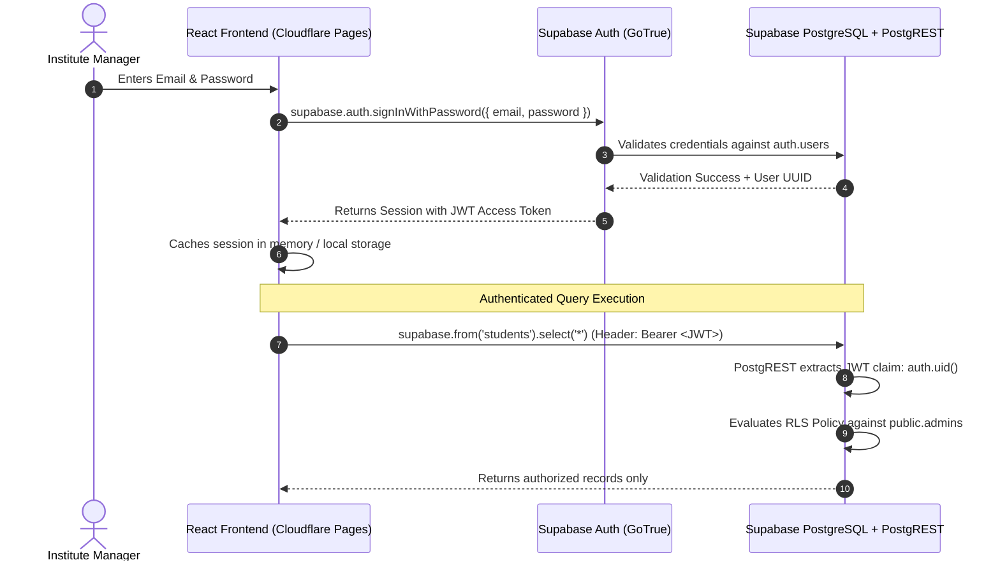

# Authentication & Security Architecture

## 1. Security Baseline & Philosophy

The Computer Institute Management System enforces a **defense-in-depth** security architecture. Security boundaries are established across three distinct layers:
1. **Network & Presentation Edge:** Cloudflare DDoS mitigation, SSL/TLS 1.3 termination, and client-side route guards.
2. **Database Engine Layer (Primary Security Boundary):** PostgreSQL Row Level Security (RLS) policies enforcing authorization on every single query.
3. **Immutable Ledger Rules:** Database-level revocation of `UPDATE` and `DELETE` privileges on financial tables to guarantee tamper-proof audit trails.

---

## 2. Authentication Flow: Supabase Auth

Authentication is handled via **Supabase Auth** (built on GoTrue), issuing cryptographically signed JSON Web Tokens (JWTs).



---

## 3. PostgreSQL Row Level Security (RLS) Policies

All operational tables have `ROW LEVEL SECURITY` enabled. Access is denied by default to all callers unless an explicit policy grants access:

```sql
-- Enable RLS across all tables
ALTER TABLE public.admins ENABLE ROW LEVEL SECURITY;
ALTER TABLE public.students ENABLE ROW LEVEL SECURITY;
ALTER TABLE public.fee_payments ENABLE ROW LEVEL SECURITY;
ALTER TABLE public.attendance ENABLE ROW LEVEL SECURITY;

-- 1. ADMINS TABLE POLICIES
CREATE POLICY "Admins can view all admin records" ON public.admins
    FOR SELECT TO authenticated
    USING (EXISTS (SELECT 1 FROM public.admins WHERE user_id = auth.uid()));

CREATE POLICY "Super admin can manage admin profiles" ON public.admins
    FOR ALL TO authenticated
    USING (EXISTS (SELECT 1 FROM public.admins WHERE user_id = auth.uid() AND role = 'super_admin'))
    WITH CHECK (EXISTS (SELECT 1 FROM public.admins WHERE user_id = auth.uid() AND role = 'super_admin'));

-- 2. STUDENTS TABLE POLICIES
CREATE POLICY "Admins full operational access to students" ON public.students
    FOR ALL TO authenticated
    USING (EXISTS (SELECT 1 FROM public.admins WHERE user_id = auth.uid()))
    WITH CHECK (EXISTS (SELECT 1 FROM public.admins WHERE user_id = auth.uid()));

-- 3. ATTENDANCE TABLE POLICIES
CREATE POLICY "Admins full operational access to attendance" ON public.attendance
    FOR ALL TO authenticated
    USING (EXISTS (SELECT 1 FROM public.admins WHERE user_id = auth.uid()))
    WITH CHECK (EXISTS (SELECT 1 FROM public.admins WHERE user_id = auth.uid()));

-- 4. FEE PAYMENTS TABLE: IMMUTABLE AUDIT POLICIES
-- Anyone authenticated as an admin can read payments
CREATE POLICY "Admins can view payment ledger" ON public.fee_payments
    FOR SELECT TO authenticated
    USING (EXISTS (SELECT 1 FROM public.admins WHERE user_id = auth.uid()));

-- Admins can insert standard installment payments (non-reversals)
CREATE POLICY "Admins can record regular payments" ON public.fee_payments
    FOR INSERT TO authenticated
    WITH CHECK (
        EXISTS (SELECT 1 FROM public.admins WHERE user_id = auth.uid())
        AND is_reversal = false
    );

-- STRICT INVARIANT: NO UPDATE OR DELETE POLICIES EXIST FOR fee_payments
-- Any attempt to UPDATE or DELETE rows in fee_payments is blocked by PostgreSQL
```

---

## 4. Secret Management & Key Isolation

* **Safe Client Variables (`VITE_`):**
  - `VITE_SUPABASE_URL`: The public project URL (`https://<project-ref>.supabase.co`).
  - `VITE_SUPABASE_ANON_KEY`: The public anonymous key designed specifically for client-side distribution. Safe because **RLS strictly gates all data access**.
* **Forbidden Secret (`service_role`):**
  - The Supabase `service_role` key bypasses all Row Level Security.
  - **Rule:** The `service_role` key is **strictly forbidden** from appearing in frontend code, client `.env` files, or version control.
* **Backup Secrets:**
  - Database connection strings (`SUPABASE_DB_URL`) and GPG encryption passphrases reside strictly in encrypted **GitHub Repository Secrets**.

---

## 5. Threat Modeling & Countermeasures

| Threat Vector | Attack Scenario | Implemented Mitigation |
| :--- | :--- | :--- |
| **Public Data Scraping** | Anonymous visitor queries PostgREST directly | RLS policies reject all `anon` requests; zero records returned. |
| **SQL Injection (SQLi)** | Attacker inputs SQL payloads into student search | PostgREST uses strictly parameterized queries internally; RPCs use parameterized plpgsql. |
| **Cross-Site Scripting (XSS)** | Malicious script injected into student name | React automatically escapes JSX string interpolations; input length restrictions enforced. |
| **Tampering with Past Payments** | Rogue user attempts to alter fee history | RLS grants zero `UPDATE` or `DELETE` permissions on `fee_payments`. |
| **Unauthorized Reversal** | Regular manager attempts to reverse a fee entry | `public.reverse_payment` RPC strictly validates that caller has `super_admin` role. |
| **Accidental Data Purge** | Admin accidentally deletes student with paid fees | Foreign key `ON DELETE RESTRICT` aborts deletion if payment records exist. |
| **Account Brute-Forcing** | Repeated password guessing attacks | Supabase Auth built-in rate-limiting and Cloudflare DDoS edge filtering. |
