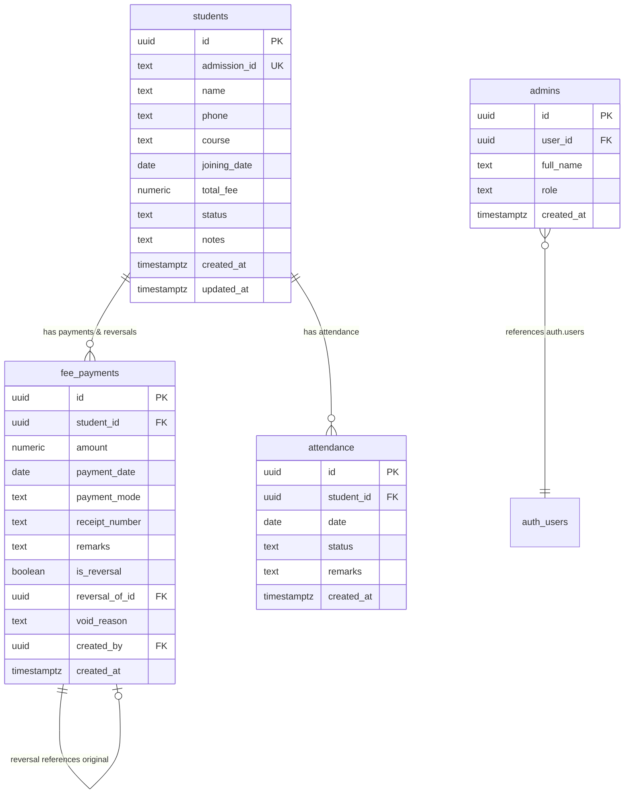

# Database Architecture

## 1. Relational Model & Schema Architecture

The database runs on **Supabase PostgreSQL (version 15/16)**. The architecture separates operational business logic from core authentication:

1. **`auth` Schema:** Managed exclusively by Supabase Auth (GoTrue). Contains authoritative user accounts (`auth.users`), password hashes, and active sessions.
2. **`public` Schema:** Contains the institute's operational business tables, immutable financial ledgers, audit logs, views, and stored functions.



---

## 2. Relational Integrity & Key Constraints

### 2.1 Primary & Foreign Keys
* **Internal UUIDs:** All operational tables utilize `gen_random_uuid()` as their internal primary key (`id`). This decouples internal record identity from human-readable business identifiers.
* **Student Deletion Protection (`ON DELETE RESTRICT`):** The `fee_payments` table references `students(id)` with `ON DELETE RESTRICT`. A student record cannot be deleted from the database if financial payment records exist.
* **Attendance Cascade (`ON DELETE CASCADE`):** If a student with zero payment history is purged from the database, associated daily attendance logs cascade and delete automatically.
* **Self-Referential Payment Reversals:** The `fee_payments` table includes `reversal_of_id UUID REFERENCES public.fee_payments(id) ON DELETE RESTRICT`. Reversal entries explicitly link back to the erroneous original payment.

### 2.2 Business Constraints
* **Case-Insensitive Admission ID Uniqueness:**
  ```sql
  CREATE UNIQUE INDEX unique_trimmed_lower_admission_id 
  ON public.students (LOWER(TRIM(admission_id)));
  ```
  Guarantees that `CIT-001` and `cit-001` are recognized as the same identifier, preventing human duplicate data entry errors while preserving visual formatting in the column.
* **Non-Negative Financials:**
  ```sql
  CONSTRAINT check_total_fee_positive CHECK (total_fee >= 0)
  CONSTRAINT check_payment_amount_positive CHECK (amount > 0)
  ```
* **Daily Attendance Uniqueness:**
  ```sql
  CONSTRAINT unique_student_daily_attendance UNIQUE (student_id, date)
  ```
  Guarantees that no student can have multiple attendance records on the same calendar day.

---

## 3. Real-Time Balance Calculation View (Accounting for Reversals)

To eliminate denormalization anomalies and ensure calculations are always consistent, financial balances are computed dynamically via an optimized PostgreSQL view that properly subtracts reversals:

```sql
CREATE OR REPLACE VIEW public.student_fee_summary AS
SELECT 
    s.id,
    s.admission_id,
    s.name,
    s.phone,
    s.course,
    s.joining_date,
    s.status,
    s.total_fee,
    COALESCE(
        SUM(
            CASE 
                WHEN p.is_reversal THEN -p.amount 
                ELSE p.amount 
            END
        ), 0.00
    ) AS total_paid,
    (
        s.total_fee - COALESCE(
            SUM(
                CASE 
                    WHEN p.is_reversal THEN -p.amount 
                    ELSE p.amount 
                END
            ), 0.00
        )
    ) AS balance_due,
    CASE 
        WHEN COALESCE(SUM(CASE WHEN p.is_reversal THEN -p.amount ELSE p.amount END), 0.00) >= s.total_fee THEN 'PAID'
        WHEN COALESCE(SUM(CASE WHEN p.is_reversal THEN -p.amount ELSE p.amount END), 0.00) > 0 THEN 'PARTIAL'
        ELSE 'UNPAID'
    END AS fee_status
FROM public.students s
LEFT JOIN public.fee_payments p ON s.id = p.student_id
GROUP BY s.id;
```

---

## 4. Stored Database Functions (RPC)

For atomic, multi-statement workflows requiring elevated validation:

### 4.1 Batch Attendance Marking Function
```sql
CREATE OR REPLACE FUNCTION public.mark_batch_attendance(
    p_date DATE,
    p_records JSONB
)
RETURNS JSONB
LANGUAGE plpgsql
SECURITY DEFINER
SET search_path = public
AS $$
DECLARE
    v_rec JSONB;
    v_count INT := 0;
BEGIN
    -- Verify caller is an authorized admin
    IF NOT EXISTS (SELECT 1 FROM public.admins WHERE user_id = auth.uid()) THEN
        RAISE EXCEPTION 'Unauthorized';
    END IF;

    FOR v_rec IN SELECT * FROM jsonb_array_elements(p_records)
    LOOP
        INSERT INTO public.attendance (student_id, date, status, remarks)
        VALUES (
            (v_rec->>'student_id')::UUID,
            p_date,
            v_rec->>'status',
            v_rec->>'remarks'
        )
        ON CONFLICT (student_id, date)
        DO UPDATE SET
            status = EXCLUDED.status,
            remarks = EXCLUDED.remarks,
            created_at = timezone('utc', now());
        
        v_count := v_count + 1;
    END LOOP;

    RETURN jsonb_build_object('success', true, 'recorded_count', v_count);
END;
$$;
```

### 4.2 Authorized Payment Reversal Function
```sql
CREATE OR REPLACE FUNCTION public.reverse_payment(
    p_payment_id UUID,
    p_reason TEXT
)
RETURNS UUID
LANGUAGE plpgsql
SECURITY DEFINER
SET search_path = public
AS $$
DECLARE
    v_orig public.fee_payments%ROWTYPE;
    v_reversal_id UUID;
    v_actor_role TEXT;
BEGIN
    -- Only super_admin can reverse a payment
    SELECT role INTO v_actor_role FROM public.admins WHERE user_id = auth.uid();
    IF v_actor_role IS NULL OR v_actor_role != 'super_admin' THEN
        RAISE EXCEPTION 'Only super_admin can reverse payments';
    END IF;

    IF length(trim(p_reason)) < 5 THEN
        RAISE EXCEPTION 'A valid justification reason is required for reversals';
    END IF;

    -- Fetch original payment
    SELECT * INTO v_orig FROM public.fee_payments WHERE id = p_payment_id;
    IF NOT FOUND THEN
        RAISE EXCEPTION 'Payment record not found';
    END IF;

    IF v_orig.is_reversal THEN
        RAISE EXCEPTION 'Cannot reverse an existing reversal entry';
    END IF;

    -- Check if already reversed
    IF EXISTS (SELECT 1 FROM public.fee_payments WHERE reversal_of_id = p_payment_id) THEN
        RAISE EXCEPTION 'Payment has already been reversed';
    END IF;

    -- Insert offsetting reversal record
    INSERT INTO public.fee_payments (
        student_id,
        amount,
        payment_date,
        payment_mode,
        receipt_number,
        remarks,
        is_reversal,
        reversal_of_id,
        void_reason,
        created_by
    ) VALUES (
        v_orig.student_id,
        v_orig.amount,
        CURRENT_DATE,
        v_orig.payment_mode,
        'REV-' || COALESCE(v_orig.receipt_number, v_orig.id::TEXT),
        'Authorized reversal: ' || p_reason,
        true,
        v_orig.id,
        p_reason,
        auth.uid()
    ) RETURNING id INTO v_reversal_id;

    RETURN v_reversal_id;
END;
$$;
```

---

## 5. Indexing Strategy

| Table | Index Name | Indexed Columns | Justification |
| :--- | :--- | :--- | :--- |
| `students` | `unique_trimmed_lower_admission_id` | `LOWER(TRIM(admission_id))` | Case-insensitive unique check & fast lookup. |
| `students` | `idx_students_name` | `name` | Substring and prefix searches. |
| `students` | `idx_students_phone` | `phone` | Instant phone lookups. |
| `students` | `idx_students_course` | `course` | Course-wise filtering. |
| `students` | `idx_students_status` | `status` | Active vs. dropped filtering. |
| `fee_payments` | `idx_payments_student_id` | `student_id` | Fast join on student payments ledger. |
| `fee_payments` | `idx_payments_date` | `payment_date` | Date-range financial reporting. |
| `fee_payments` | `idx_payments_reversal` | `reversal_of_id` | Fast check for existing reversals. |
| `attendance` | `idx_attendance_date` | `date` | Date-wise class attendance retrieval. |
| `attendance` | `idx_attendance_student_date` | `student_id, date` | Unique check & individual history lookup. |
