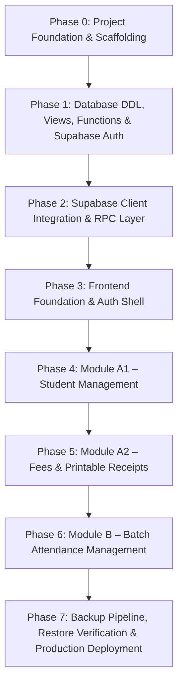

# Master Implementation Plan

## 1. Implementation Philosophy & Governance

The implementation of the Computer Institute Management System follows an incremental, test-driven, phase-by-phase execution model. Each phase produces a verifiable deliverable before the subsequent phase commences.

### Strict Governance Rules
1. **No Code Before Documentation Sign-off:** No application code or project directories may be created until this plan is formally approved.
2. **One Phase at a Time:** Phase $N+1$ cannot begin until Phase $N$ meets all defined acceptance criteria.
3. **Continuous Data Integrity:** All database migrations must be tested and paired with a pre-migration backup before execution.
4. **Mandatory Backup Gate:** Production deployment (Phase 7) cannot proceed until the automated offsite backup pipeline is verified with a successful test restoration drill.
5. **Zero Cost Discipline:** Every tool, package, and service added must comply with the ₹0 budget constraint.

---

## 2. Phase Sequence & Dependency Graph

---

## 3. High-Level Phase Breakdown

| Phase | Title | Primary Objective | Key Deliverables |
| :---: | :--- | :--- | :--- |
| **0** | **Project Foundation** | Initialize local environment, Git, and project structure | Git repo, directory scaffolding, `.gitignore`, shared configs |
| **1** | **Database & Auth** | Provision Supabase, DDL migrations, views, RPCs, and RLS | SQL migrations, views, stored functions, initial Super Admin |
| **2** | **Client API Integration** | Configure Supabase JS client and RPC wrappers | `@supabase/supabase-js` client layer, type definitions, RPC helpers |
| **3** | **Frontend Foundation** | Build React SPA shell, layout, and Supabase Auth views | Vite setup, Tailwind design system, login page, route guards |
| **4** | **Student Management** | Implement student directory, add/edit modal, search/filter | Students table UI, normalized Admission ID checks, search bar |
| **5** | **Fees Management** | Implement fee collection, reversal workflow, and receipts | Payment modal, reversal modal (Super Admin), print CSS receipt |
| **6** | **Attendance Management** | Implement batch attendance marking & history tracking | Batch sheet, pre-submit review, atomic batch upsert RPC |
| **7** | **Testing & Deployment** | Backup pipeline, restore verification, Cloudflare Pages | Automated backup workflow, restore drill, live production URL |

---

## 4. Phase Completion Criteria & Sign-Off Checklist

A phase is deemed complete only when:
1. All step-by-step tasks defined in the respective phase document are executed without errors.
2. Unit and integration tests for that phase pass with 100% success.
3. Security requirements and secret isolation rules are verified.
4. The deliverables are committed to the Git repository with clear semantic commit messages.
5. The institute owner reviews and signs off on the phase milestone.

---

## 5. Technical Risk Matrix & Mitigation Strategy

| Risk Factor | Impact | Mitigation Strategy |
| :--- | :--- | :--- |
| **Inactivity Pausing on Supabase Free** | Compute pauses after 7 days of inactivity | Daily institute use naturally prevents pausing; 1-click restore brings DB back in 2–4 min. |
| **Accidental Payment Entry Error** | Corrupts accounting balances | Immutable ledger policy with authorized reversal entries (`reversal_of_id`) preserves audit trail. |
| **Accidental Student Deletion with Payments** | Corrupts financial audit trail | Foreign key `ON DELETE RESTRICT` strictly prevents deletion if payments exist. |
| **Duplicate Attendance Records** | Distorts monthly attendance calculations | Hard database constraint `UNIQUE(student_id, date)` blocks duplicates at engine level. |
| **Catastrophic Cloud Host Outage** | Application unavailable | Daily automated full backups encrypted in Cloudflare R2 and GitHub allow rapid recovery to any Postgres host. |
