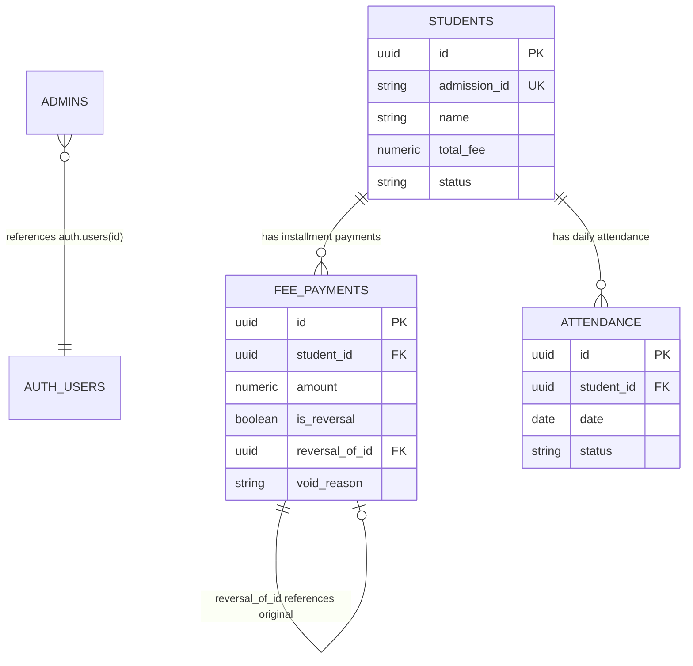

# Database Relationships & Integrity Rules

## 1. Entity Relationship Overview

The database adheres strictly to Third Normal Form (3NF). Relationships are established using explicit foreign key constraints with strict referential action rules designed for financial audit compliance and data integrity.



---

## 2. Cardinality & Foreign Key Rules

### 2.1 `students` $\rightarrow$ `fee_payments` (1-to-Many)
* **Cardinality:** One student can have zero, one, or many fee payment and reversal records ($1 : N$).
* **Constraint:**
  ```sql
  FOREIGN KEY (student_id) REFERENCES public.students(id) ON DELETE RESTRICT
  ```
* **Integrity Rationale (`ON DELETE RESTRICT`):**
  - **Financial Audit Guarantee:** If a student is admitted and makes a payment of ₹2,000, that payment represents actual cash collected by the institute.
  - If an administrative user accidentally attempts to delete the student from the database, PostgreSQL **aborts the transaction and rejects the deletion**.
  - To deactivate a student who has payments, the administrator must change their `status` to `'dropped'` or `'completed'`. The student record and all historical receipts remain intact for accounting audits.

### 2.2 `fee_payments` $\rightarrow$ `fee_payments` (Self-Referential Reversal, 1-to-1)
* **Cardinality:** An original payment record may have at most one corresponding reversal record ($1 : 0..1$).
* **Constraint:**
  ```sql
  FOREIGN KEY (reversal_of_id) REFERENCES public.fee_payments(id) ON DELETE RESTRICT
  ```
* **Integrity Rationale (`ON DELETE RESTRICT`):**
  - Prevents breaking the audit link between an original payment and its offsetting void entry.
  - An original payment that has been reversed cannot be detached from its reversal entry.

### 2.3 `students` $\rightarrow$ `attendance` (1-to-Many)
* **Cardinality:** One student has zero, one, or many daily attendance logs ($1 : N$).
* **Constraint:**
  ```sql
  FOREIGN KEY (student_id) REFERENCES public.students(id) ON DELETE CASCADE
  ```
* **Integrity Rationale (`ON DELETE CASCADE`):**
  - If a student was added by mistake (e.g. duplicate data entry on the same day) and has **zero** fee payments, deleting the student automatically cleans up any transient attendance records, preventing orphaned attendance logs.

### 2.4 `auth.users` $\rightarrow$ `public.admins` (1-to-1)
* **Cardinality:** Each `public.admins` record corresponds to exactly one authenticated Supabase Auth identity ($1 : 1$).
* **Constraint:**
  ```sql
  FOREIGN KEY (user_id) REFERENCES auth.users(id) ON DELETE CASCADE
  ```
* **Integrity Rationale:**
  - If an admin user is revoked or deleted from Supabase Auth, their corresponding profile in `public.admins` is automatically removed.

---

## 3. Student Archival vs. Destructive Deletion

To guarantee compliance with financial auditing and historical educational record keeping:

| Student Lifecycle State | Database Action | Permitted Operation |
| :--- | :--- | :--- |
| **Active Enrollment** | `status = 'active'` | Mark attendance, record payments, print receipts. |
| **Course Completed** | `status = 'completed'` | Excluded from daily attendance sheet; payment history permanently preserved. |
| **Course Abandoned / Dropped** | `status = 'dropped'` | Excluded from daily attendance sheet; outstanding dues & payments preserved. |
| **Accidental Entry (Zero Payments)** | `DELETE FROM students WHERE id = ...` | Allowed; cascades transient attendance logs cleanly. |
| **Student with Payment History** | `DELETE FROM students WHERE id = ...` | **BLOCKED BY DATABASE** (`ON DELETE RESTRICT`). Must use status change instead. |
